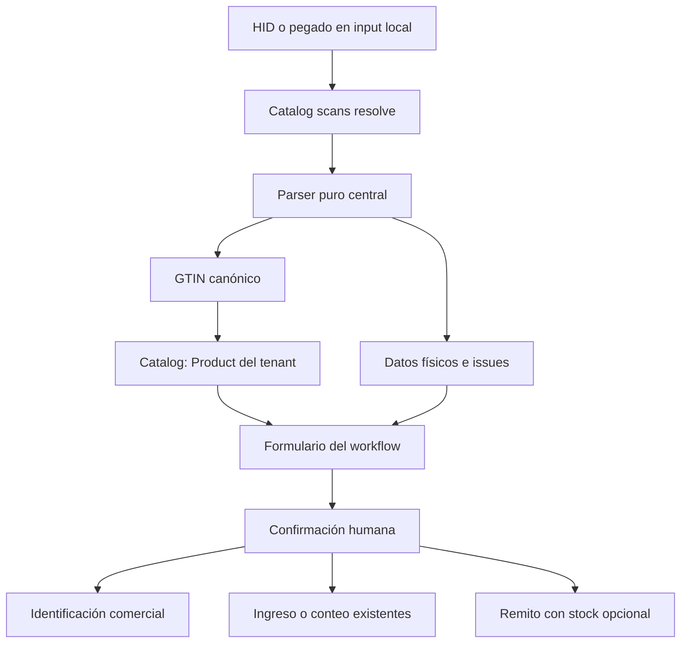

# GS1 V1: análisis y diseño técnico

Fecha: 26 de octubre de 2026. Estado: **diseño de referencia; Stages 1–5 implementados**.

Actualización: Stages 1–5 implementados sobre este diseño. Stage 5 agrega DeliveryNoteLineTrace, snapshots documentales e impresión sin Inventory. Ver [implementación y verificación](gs1-verification.md). La consulta operativa de esos datos está en [Trazabilidad](traceability.md). El resto del documento se conserva como diseño.

HEAD analizado: `c34f8ff8ff2c3f8215348507c850b02b24bcd9a8`, branch `main`, commit `remito sin stock y mas`. Al comenzar, `git status` informó árbol limpio y branch sincronizada con `origin/main` según las referencias locales; no se hizo fetch. Commits anteriores revisados: `7bf06ba` (fix bug diseño), `3b6c938` (plantilla remitos 3), `96b797f` (plantilla remito 2), `5742465` (plantilla remito), `037476d` (Implementacion impresion sobre talonario).

Este documento distingue el comportamiento observado del diseño futuro. No modifica código productivo, contratos, dependencias, schema ni datos. No autoriza una implementación, migración, commit o push.

## 1. Decisión y límites del incremento

Recomendar **un único parser puro, interno y acotado a los AIs 01/10/17/21**, inicialmente ejecutado solamente en backend. Extender la resolución de códigos existente para devolver identidad comercial y datos físicos separados. Reutilizar Product Identification, Receipt, Initial Count y posting de Inventory. El parser y estas integraciones básicas no necesitan migración ni dependencia externa nueva.

Recomendar **sí** a trazabilidad física documental independiente de Inventory, en una etapa propia que sí necesitará schema, migración y adaptación de Printing. La ausencia de stock registrado seguirá permitiendo emitir Remitos. Esa etapa debe preceder a la publicación de una experiencia que prometa conservar/imprimir lote o serie escaneados sin stock.

El problema actual no es crear otra gestión de productos: una sola lectura rica se descarta como `UNSUPPORTED` y obliga a reingresar manualmente datos que Inventory ya sabe representar. Se deben separar tres conceptos:

| Concepto                   | Autoridad y significado                                                             |
| -------------------------- | ----------------------------------------------------------------------------------- |
| Identidad comercial        | `ProductIdentifier GTIN → Product`, dentro de Organization.                         |
| Identidad física declarada | Lote, vencimiento, serie leídos o ingresados; no demuestra existencia.              |
| Existencia registrada      | InventoryLot/Serial + posición, condición y saldo, sujetos a reglas y concurrencia. |

Fuera de alcance: rediseño de módulos, todas las demás AIs como datos de negocio, cámara, conversiones de packaging, ANMAT, registro UDI, facturación, nuevos sonidos, design system, infraestructura/deploy, PrintAsset/private storage, geometría/calibración/numeración de impresión, event bus, microservicios, Redis y frameworks de plugins.

## 2. Estado actual verificado en el repositorio

Las rutas de esta tabla son relativas a la raíz. Son el mapa de implementación para el siguiente agente.

| Archivo/símbolo                                                                                                                 | Hallazgo y consecuencia                                                                                                                                                                                                                                                                               |
| ------------------------------------------------------------------------------------------------------------------------------- | ----------------------------------------------------------------------------------------------------------------------------------------------------------------------------------------------------------------------------------------------------------------------------------------------------- |
| `apps/api/src/modules/catalog/domain/catalog-scan.ts`, `parseScan`                                                              | Aplica `trim()`. Antes de los namespaces detecta paréntesis 01/10/17/21 en cualquier posición, AIM `]C1`, `]d2`, `]Q3` inicial, GS en cualquier posición o `01 + 14 dígitos + 10/17/21`. Devuelve `UNSUPPORTED`, incluso en INTERNAL_CODE. No extrae datos.                                           |
| `apps/api/src/modules/catalog/domain/identifiers.ts`, `normalizeIdentifier`                                                     | GTIN de 8/12/13/14 dígitos, módulo 10 y `padStart(14, '0')`. Otros identificadores conservan case y puntuación; máximo 128 y rechazo de controles. No rescata GTIN inválido como externo.                                                                                                             |
| `packages/contracts/src/identification.ts`                                                                                      | Entrada strict: value de 1 a 512, AUTO/INTERNAL_CODE, supplierId opcional. Salida strict con KNOWN/UNKNOWN/CANDIDATES/ARCHIVED/AMBIGUOUS/INVALID/UNSUPPORTED.                                                                                                                                         |
| `apps/api/src/modules/catalog/application/identification.service.ts`                                                            | Resolución exacta scoped; candidatos por GTIN declarado del proveedor. Confirmación humana con operationId, hash del comando, versiones, locks, autorización transaccional y audit allowlisted. No guarda el scan en CatalogIdentification.                                                           |
| `apps/web/src/components/catalog/identification.tsx`, `ProductIdentification`                                                   | Input controlado, foco local, `maxLength=512`, `onChange` actualiza estado y limpia resultado, submit del form al Enter. Ref síncrona impide doble submit. No request por carácter ni debounce de scanner. Deshabilitado durante request.                                                             |
| `apps/web/src/components/inventory/operations.tsx`, `scan/add/claim`                                                            | Receipt y Count comparten captura. Resolve → política → preformulario → Agregar con PUT de línea. Hoy reinicia lote/fecha/series al escanear. En Count, reconocer con política puede reclamar scope persistido: es comportamiento del workflow de conteo, no del parser ni de Product Identification. |
| `packages/contracts/src/inventory.ts`                                                                                           | Texto físico: trim de extremos, 1–128 caracteres, controles prohibidos, case conservado. Fecha ISO de calendario. Series únicas en línea, máximo 100.                                                                                                                                                 |
| `apps/api/src/modules/inventory/application/inventory.service.ts`                                                               | Política requerida para ingresar; serialRequired exige cantidad igual al número de series, false rechaza series. Lote/fecha no obligatorios pueden suministrarse. Conflictos de lote/vencimiento no se sobrescriben.                                                                                  |
| `packages/database/prisma/schema.prisma`                                                                                        | ProductIdentifier unique `(organizationId, kind, normalizedValue)`; lote unique `(organizationId, productId, normalizedLotNumber)`; serie unique `(organizationId, productId, normalizedSerialNumber)`. No son globales.                                                                              |
| `apps/api/src/modules/inventory/domain/quantity.ts`                                                                             | Cantidad exacta BigInt escala 10⁶; fecha de negocio `America/Argentina/Buenos_Aires`; vencido si fecha menor a hoy, inclusivo el día de vencimiento.                                                                                                                                                  |
| `apps/api/src/modules/delivery-notes/application/delivery-notes.service.ts` y `InventoryService.postDeliveryNote`               | Remito acepta cero, parte o todas las allocations. Suma asignada no mayor a cantidad documental. Sin allocations no hay movimiento; con ellas hay un único OUTBOUND y se mantienen todas las defensas de Inventory.                                                                                   |
| `apps/api/src/modules/delivery-notes/application/delivery-note-view.ts`                                                         | Snapshot comercial en confirmado; campos físicos expuestos hoy desde `allocation.position.lot/serial`. No existe trace independiente.                                                                                                                                                                 |
| `apps/api/src/modules/printing/domain/print-document.ts`, `geometry.ts/projectRows`; `application/printing.service.ts/document` | Printing consume esa vista. Filas físicas derivan de allocations; el resto de cantidad se imprime con trace vacío. Hay snapshots físicos en InventoryMovementLine, pero esta lectura documental no los consulta directamente.                                                                         |
| `20261006180000_catalog_identification/migration.sql`                                                                           | Constraint impide guardar GS1 detectable/controles/GTIN/MB- en SupplierScanIdentifier. Se conserva como defensa; parser V1 no requiere alterarlo.                                                                                                                                                     |
| `20261026120000_delivery_optional_inventory/migration.sql`                                                                      | Trigger diferido exige movimiento si y solo si hay allocations en confirmado, snapshots comerciales y correspondencia exacta allocation → delta OUTBOUND. No volver a exigir stock universal.                                                                                                         |

Documentos de contexto: [identificación](product-identification.md), [Inventory implementado](inventory.md), [Remitos](delivery-notes.md), [Printing](delivery-note-printing.md). Algunos párrafos históricos dicen que Inventory/OUTBOUND eran futuros; para este diseño prevalecen código y migraciones del HEAD informado.

### 2.1 Qué conservar y qué reemplazar de la detección actual

Conservar la precedencia protectora ante intención GS1 y los fixtures de no degradación a código externo. Conservar el checksum/canonicalización, namespaces, scopes y workflow de identificación. Reemplazar el retorno incondicional `UNSUPPORTED` por una clasificación estructural y el parser central. Retirar la regex ad hoc como intérprete; no replicarla en Receipt o Remitos.

El patrón actual no cubre `01 + GTIN14` solo ni órdenes alternativos sin marcas; además reconoce `(10)` dentro de un código arbitrario. Es un detector preventivo, no evidencia de que un contenido sea GS1 válido. La futura clasificación debe hacer esas limitaciones explícitas y probar la compatibilidad de los códigos existentes.

## 3. Referencias oficiales y terminología

Consulta realizada el 26/10/2026. Base normativa: **GS1 General Specifications 26.0, enero de 2026**, 579 páginas, enlace versionado. La página comercial de GS1 todavía mostraba 25.0 en el índice consultado; se verificó el PDF 26.0 y su archivo oficial.

| Fuente                                                                                                                                                     | Uso en este diseño                                                                                                                            |
| ---------------------------------------------------------------------------------------------------------------------------------------------------------- | --------------------------------------------------------------------------------------------------------------------------------------------- |
| [GS1 General Specifications 26.0](https://ref.gs1.org/standards/genspecs/26.0.0/) y [archivo de versiones](https://ref.gs1.org/standards/genspecs/archive) | §3.3.2 GTIN; §3.4.1 lote (p.210); §3.4.7 vencimiento (pp.213–214); §3.5.2 serie (p.215); §7.11, tabla 7-20 (p.551); §7.12 siglo (pp.553–554). |
| [Definiciones de AI](https://ref.gs1.org/ai/) y [GS1 Barcode Syntax Dictionary](https://github.com/gs1/gs1-syntax-dictionary)                              | Longitudes, tipos, separadores y asociación de AIs. Referencia para fixtures; no descargar diccionario en runtime.                            |
| [GS1 DataMatrix Guideline 2.5.1](https://ref.gs1.org/guidelines/datamatrix/)                                                                               | §§2.2, 2.3, 3.3: FNC1, HRI, longitud predefinida y transmisión. Es de 2018; para fechas prevalece General Specifications 26.0.                |
| [Implementación oficial de scan data](https://github.com/gs1/gs1-syntax-engine/blob/main/src/c-lib/scandata.c)                                             | Diferencia de identificadores AIM `C1`, `d2`, `Q3` frente a transportes no AI.                                                                |
| [Cambio de fechas healthcare, GS1 Sweden](https://gs1.se/en/news/change-of-date-format-for-regulated-healthcare-products/)                                 | Corrobora la restricción de día 00 desde enero de 2025 para productos de salud regulados.                                                     |
| [GS1 Digital Link URI Syntax 1.7.0](https://ref.gs1.org/standards/digital-link/uri-syntax/1.7.0/)                                                          | Extensión futura, separada de element strings.                                                                                                |
| [GS1 UDI](https://www.gs1.org/industries/healthcare/udi)                                                                                                   | Relación conceptual DI/PI, sin afirmar cumplimiento regulatorio.                                                                              |
| [HTML Standard, input](https://html.spec.whatwg.org/multipage/input.html)                                                                                  | Sanitización de input text: elimina saltos de línea, no prescribe eliminar U+001D.                                                            |

Un DataMatrix ISO genérico es un portador de datos; no garantiza sintaxis GS1. GS1 DataMatrix usa reglas GS1 y FNC1 inicial. GS1-128 es el uso GS1 de Code 128, también diferenciado mediante FNC1. Un QR genérico puede devolver texto/URL arbitrarios; GS1 QR en modo FNC1 puede transportar element strings. Un QR o DataMatrix que transporte una URI GS1 Digital Link necesita otro intérprete. **El parser recibe texto, no identifica visualmente el símbolo ni certifica la etiqueta.** [Guía DataMatrix](https://ref.gs1.org/guidelines/datamatrix/), [Digital Link](https://ref.gs1.org/standards/digital-link/uri-syntax/1.7.0/).

## 4. Arquitectura de código recomendada

V1: backend central con dominio puro en `apps/api/src/common/domain/scanning/`. No crear paquete workspace aún: la UI necesita el Product resuelto por DB de todos modos; ejecutar también un parser local duplicaría el trabajo y complicaría fecha/versión sin beneficio operativo demostrado.

Archivos futuros, **no creados por esta tarea**:

| Archivo                                                 | Responsabilidad                                                                                                                                                              |
| ------------------------------------------------------- | ---------------------------------------------------------------------------------------------------------------------------------------------------------------------------- |
| `common/domain/scanning/gs1.ts`                         | Clasificar, tokenizar, validar los cuatro AIs y devolver el resultado. Sin imports Nest, Prisma, HTTP, React o Zod.                                                          |
| `common/domain/scanning/gtin.ts`                        | Extraer mecánicamente el algoritmo GTIN actual a una función pura compartida por `normalizeIdentifier` y GS1. Un solo checksum; conservar mensajes de Catalog en su wrapper. |
| `common/domain/scanning/gs1-types.ts`                   | Tipos y reason codes del dominio. Puede integrarse en gs1.ts si queda pequeño; no framework.                                                                                 |
| `modules/catalog/domain/catalog-scan.ts`                | Adaptador de clasificación GS1/legacy y construcción de ScanIdentity.                                                                                                        |
| `modules/catalog/application/identification.service.ts` | Resolver únicamente identidad comercial y adjuntar resultado de interpretación.                                                                                              |
| `packages/contracts/src/identification.ts`              | Esquemas de transporte estrictos para resultado y errores; no contener el algoritmo.                                                                                         |
| `apps/web/src/components/inventory/operations.tsx`      | Mapear campos confirmados por API al formulario existente de Receipt/Count.                                                                                                  |

El reloj no vive dentro del parser. Firma conceptual: `parseGs1(raw: string, options: { referenceYear: number }): Gs1ParseResult`. Año obligatorio, derivado por el caso de uso de la fecha actual de negocio argentina; no de documentDate elegida por el usuario. Misma entrada y options, mismo resultado. No DB, hora global, random, red, logs ni efectos laterales.

Si una necesidad medida exige UX offline/local, mover ese mismo directorio a `packages/scanning` puro y consumirlo desde ambos lados. Esa extracción no cambia semántica; backend vuelve a validar. No importar módulos API desde Next ni copiar el parser.



## 5. Formatos y normalización de transporte

### 5.1 Formatos admitidos

Se usan fixtures con GTIN válido `04006381333931`. El ejemplo de la consigna `07791234567890` **falla el checksum existente**: es un fixture negativo, no corregirlo silenciosamente ni afirmar que identifica un producto real.

| Entrada                                              | Interpretación                                                       |
| ---------------------------------------------------- | -------------------------------------------------------------------- |
| `4006381333931`                                      | GTIN legacy; canónico `04006381333931`, no requiere sintaxis GS1.    |
| `(01)04006381333931(17)281231(10)LOTE123(21)SERIE45` | Representación humana delimitada por AIs parentizados.               |
| `01040063813339311728123110LOTE123<GS>21SERIE45`     | Element string; aquí `<GS>` denota un único U+001D real.             |
| `]d201040063813339311728123110LOTE123<GS>21SERIE45`  | Mismo contenido con metadata AIM de GS1 DataMatrix.                  |
| `]C101040063813339311728123110LOTE123`               | GS1-128, lote final sin separador.                                   |
| `]Q30104006381333931`                                | Element string con AIM de GS1 QR; no implica cámara ni Digital Link. |

### 5.2 Normalización exacta

1. Verificar tipo y longitud **antes** de operar: `MAX_SCAN_LENGTH = 512` unidades UTF-16, alineado con el contrato actual. No truncar. Toda entrada GS1 válida del subconjunto usa ASCII. Limitar además a 32 elementos y 16 issues; cortar con error explícito al excederlos, nunca devolver éxito parcial por truncamiento del límite.
2. Permitir quitar espacios ASCII `U+0020` antes del primer carácter de encuadre (para pegado humano) y un único terminador final CRLF, CR, LF o TAB. No usar `trim()` general sobre el candidato GS1: ocultaría controles y podría alterar un valor final. Rechazar espacios finales en datos GS1 y whitespace interno; no quitar espacios de lote/serie. Para NOT_GS1 sigue el trim legacy existente.
3. Extraer **un solo** AIM admitido, únicamente al inicio. Retenerlo como metadata; jamás parte del GTIN/lote/serie. No aceptar prefijos repetidos ni convertir mayúsculas/minúsculas (`]d2` es exacto).
4. U+001D es el separador interno. `\x1D` es notación en código, no cuatro caracteres que deban reemplazarse. En JSON se transmite escapado como `\u001d`; JSON.parse reconstruye el carácter.
5. No convertir globalmente `<GS>`, `{GS}`, `^`, `~`, `|`, el carácter gráfico `␝` o secuencias literales `\x1D` en GS. Algunos son valores legítimos o configuraciones particulares. Un adaptador HID validado puede insertar GS; el parser no adivina configuraciones.
6. Rechazar NUL, DEL, C0 excepto GS interno y terminador final admitido, C1, Unicode fuera del conjunto GS1, sustitutos inválidos y mezclas de formatos. No NFKC, decodificación URL, eliminación de guiones, uppercase ni cambios de ceros.

Leading GS no representa por sí mismo un FNC1 inicial correctamente transmitido: V1 lo rechaza como separador inesperado; configurar el lector para AIM y separadores entre elementos. GS dobles, iniciales y finales también se rechazan; son errores de transporte explícitos, no campos vacíos ignorados. Si hardware real exige una tolerancia, incorporarla al adaptador con fixture exacto y advertencia, sin reinterpretar silenciosamente el dominio.

### 5.3 AIM y precedencia

| Prefijo             | Decisión V1                                                                                                                                                                                                                                                        |
| ------------------- | ------------------------------------------------------------------------------------------------------------------------------------------------------------------------------------------------------------------------------------------------------------------ |
| `]C1`, `]d2`, `]Q3` | Reconocer intención GS1, retirar tres caracteres, guardar symbology metadata y parsear element string.                                                                                                                                                             |
| `]C0`, `]d1`, `]Q1` | Reconocer como portador genérico, no convertirlo en GS1 por su parecido. No retirar para lookup legacy; conserva la identidad externa actual. Si pretende llevar GS1 compuesto, devolver UNSUPPORTED/FORMAT_CONFLICT y pedir configuración o pegado HRI explícito. |
| Otros `]…`          | No retirar un prefijo desconocido. Un AIM fuera del soporte con indicios GS1 produce UNSUPPORTED_SYMBOLOGY; sin indicios sigue clasificación legacy conservando el texto. No inferir cómo decodificar `]e0`/otros portadores.                                      |
| Sin AIM             | Admitir HRI o estructura acotada de element string; `symbology=null`, no afirmar DataMatrix.                                                                                                                                                                       |

La distinción `d1/d2` y `Q1/Q3` también aparece en el [scan processor oficial](https://github.com/gs1/gs1-syntax-engine/blob/main/src/c-lib/scandata.c). AIM con payload HRI parentizado se rechaza como formato mixto: retirar el AIM manualmente si se pega HRI.

Orden de clasificación para AUTO y protección de INTERNAL_CODE:

1. Límites/controles; marcas fuertes GS1 (AIM admitido, GS, HRI inicial `(NN)` de 2–4 dígitos). Esas marcas nunca degradan a supplier/internal ante fallo.
2. Reservar también las detecciones compuestas que hoy ya impiden persistencia (por ejemplo marcador soportado incrustado en texto); si no cumplen una gramática admitida, error de formato, no rescate externo.
3. Sin marcas: conservar primero los GTIN numéricos legacy de 8/12/13/14. Después detectar `01` con longitud total al menos 16 como candidato element string (incluso checksum incorrecto) y `17` + seis dígitos + al menos otro elemento 01 completo. Requieren parse integral, AI01 único y válido. Una cadena `01` truncada reconocible con evidencia AIM/HRI es INVALID; un código externo corto sin evidencia sigue legacy.
4. Los órdenes que empiezan por 10/21 requieren GS para continuar hasta 01, o HRI/AIM explícito. `10ABC` aislado sin marca no es suficiente evidencia GS1. Todos los órdenes de los cuatro AIs correctamente delimitados quedan cubiertos; no se busca un `01` dentro de texto variable.
5. NOT_GS1 → algoritmo actual INTERNAL_CODE explícito, GTIN, MB-, externo supplier-scoped. Si INTERNAL_CODE recibe candidato GS1, informar que cambie a AUTO; no guardarlo como código interno ni resolverlo silenciosamente en ese namespace.

Los externos sin marca que empiezan por 01 y tienen 16 o más caracteres pueden colisionar con esta ampliación. Antes de desplegar Stage 2 hacer un análisis read-only scoped de esos identificadores existentes: si los hay, bloquear la activación de detección bare para ese entorno hasta resolver configuración AIM/HRI; no reasignarlos ni migrarlos automáticamente. Esta limitación es inherente a un transporte sin symbology. El modo manual INTERNAL_CODE conserva los casos que quedan clasificados NOT_GS1; no es un escape para una lectura GS1 detectada o inválida. No habilitar cambios de detección bare sin completar el análisis de colisiones.

## 6. Algoritmo y semántica de los AIs

Parser determinista de una pasada con cursor, tablas pequeñas y validadores por campo. No regex gigante ni búsqueda libre de dígitos 01/10/17/21. Cada iteración consume entrada o termina. Complejidad O(n), memoria O(n) acotada por 512.

### 6.1 Tokenización

Element string: leer AI solamente en una frontera conocida. 01 consume exactamente 14 dígitos; 17 exactamente seis. 10/21 consumen hasta GS o fin, entre 1 y 20 caracteres. Un campo variable de 20 caracteres **no** autoriza concatenar otro AI sin GS. No cortar al encontrar números dentro del valor. Consumido GS debe seguir otro AI, nunca otro GS ni fin.

HRI: al comienzo debe haber `(NN)`; marcadores con 2–4 dígitos delimitan elementos y permiten terminar variables sin GS. Validar longitud exacta de los fijos también aquí. Esta es una gramática de ingreso humano, no una prueba de bytes del símbolo. La cadena literal `(17)` dentro de un lote es ambigua en HRI: se interpreta como delimitador por definición de ese modo. Para expresar ese lote hay que usar element string real, donde los paréntesis son datos. No inventar escape propietario. No mezclar GS y HRI.

Si un valor variable sin GS contiene `ABC1017XYZ`, todo es el lote. Incluso `ABC17281231` puede ser un lote válido: **no es posible detectar que el lector perdió un separador si el resultado todavía cumple la gramática**. Mostrar campos al operador y homologar hardware son defensas necesarias. `MISSING_SEPARATOR` se reserva para evidencia comprobable (por ejemplo variable excedida sin frontera), nunca se usa para partir heurísticamente.

### 6.2 Definición de los cuatro campos

| AI  | Validación y salida                                                                              | Regla de integración                                                                                             |
| --- | ------------------------------------------------------------------------------------------------ | ---------------------------------------------------------------------------------------------------------------- |
| 01  | 14 dígitos exactos + checksum del algoritmo actual; `gtin14`. No aceptar 8/12/13 dentro de AI01. | Resolver GTIN canónico por tenant. No búsqueda difusa ni creación automática.                                    |
| 10  | 1–20 caracteres del conjunto GS1 82; `lotNumber` idéntico.                                       | Se compara exactamente con normalizedLotNumber de ese tenant/Product.                                            |
| 17  | Seis dígitos YYMMDD; calendario y siglo definidos debajo; `expirationDate` ISO y `precision`.    | Fecha de negocio DATE, sin zona horaria dentro del campo.                                                        |
| 21  | 1–20 caracteres del conjunto GS1 82; `serialNumber` idéntico.                                    | Identidad tenant/Product/serie. Una serie corresponde a una unidad de la unidad base, sin conversión de empaque. |

Para 10/21, conjunto permitido implementable por rangos de códigos: 33–34, 37–63, 65–90, 95, 97–122. Incluye minúsculas, puntuación y paréntesis; excluye espacio, `#`, `$`, `@`, corchetes, backslash, acentos y controles. No usar un genérico `[A-Z0-9]`. Se basa en tabla 7-20 de [General Specifications](https://ref.gs1.org/standards/genspecs/26.0.0/). Inventory manual sigue permitiendo sus textos más amplios de hasta 128; no endurecer todos los lotes históricos por incorporar GS1. Los valores GS1 válidos ya son estables ante el trim actual: no tienen espacios de extremos.

### 6.3 GTIN y packaging

Reutilizar exactamente la equivalencia actual: `4006381333931` y AI01 `04006381333931` buscan la misma clave. Checksum fallido → INVALID_GTIN, sin rescate por namespace, proveedor, candidato difuso o alta de Product. El checksum valida estructura, no asignación oficial GS1 ni autenticidad.

No guardar toda la lectura como ProductIdentifier o SupplierScanIdentifier. Solo AI01 puede convertirse en ProductIdentifier GTIN. Los AIs físicos no son identificadores permanentes comerciales.

GTIN de un empaque distinto puede representar otro trade item. No agrupar por marca/nombre, ni convertir caja a unidades. El modelo actual admite varios identificadores de un Product; quien asocia debe confirmar que representan la misma unidad comercial configurada. La unicidad Product/serie puede ser más estricta que GTIN/serie cuando varios GTIN están asociados al mismo Product; conservarla y escalar conflictos de catalogación, no cambiar el scope de Inventory en este incremento.

### 6.4 Expiration: siglo, día 00 y calendario

La regla de siglo es la ventana del año corriente **Y−49 a Y+50 inclusive** (§7.12). Elegir el único año con esos dos dígitos dentro de esa ventana. No usar fijo `2000 + YY`, pivot 70 de JavaScript ni fecha del Remito. Con `referenceYear=2026`: 77→1977; 76→2076; 28→2028. Con 2027: 77→2077. El resultado registra `referenceYear` como metadata efímera para reproducir la interpretación.

Validar mes 01–12, día real del calendario gregoriano, bisiesto divisible por 4 salvo siglos no divisibles por 400. Validar aritméticamente, sin permitir rollover de `new Date`. Entrada no numérica, mes 00/13 o 29/02 en año no bisiesto produce INVALID_EXPIRATION; no publicar una fecha válida inventada.

Para el estándar general, YYMM00 se interpreta como último día del mes. Para **healthcare regulado**, GS1 exige día específico desde 01/01/2025. Son dos niveles distintos, explícitos en §3.4.7 de [General Specifications 26.0](https://ref.gs1.org/standards/genspecs/26.0.0/), corroborados por [GS1 Sweden](https://gs1.se/en/news/change-of-date-format-for-regulated-healthcare-products/).

Decisión MaxBio: el parser general conserva `expirationDate` como último día, `precision='MONTH'`, `encoded='YYMM00'` y issue de revisión `EXPIRATION_DAY_UNSPECIFIED`. La aplicación de MaxBio **no aplica automáticamente** esa fecha al formulario operativo: muestra el candidato y exige revisar etiqueta/fecha exacta antes de Agregar. Para este catálogo médico no se ofrece un simple botón que declare conformidad sanitaria; el operador completa una fecha explícita desde la etiqueta o deriva a revisión administrativa. Product no tiene hoy clasificación regulatoria suficiente para inferir una excepción. Identificar el Product sigue siendo posible. No afirmar que normalizar a fin de mes hace conforme una etiqueta healthcare actual.

Salida de negocio siempre `YYYY-MM-DD`; UI `DD/MM/YYYY`. Adaptar al patrón actual de Prisma `@db.Date` y conversión a medianoche UTC únicamente en la frontera de persistencia, con `toISOString().slice(0,10)`; no formatear ese Date en hora local y restar un día. El año se fija al interpretar; borradores guardan la fecha completa y nunca recalculan el siglo al confirmar/reimprimir. Nuevos scans al cruzar un año vuelven a interpretarse y se revisan.

### 6.5 Duplicados y AIs fuera de V1

Duplicado de cualquiera de los cuatro AIs, incluso mismo valor: `DUPLICATE_AI`, no first/last-wins. El campo duplicado queda fuera de `fields`, pero ambas ocurrencias permanecen como diagnósticos efímeros. Duplicar 01 impide resolución; duplicar 10/17/21 permite reconocer un 01 inequívoco, pero bloquea usar automáticamente el trace.

AIs no soportados:

- HRI: la frontera `(NN)` permite delimitarlos. Conservar fields soportados; reportar `UNSUPPORTED_AI` con AI/offset, sin persistir valor desconocido ni asignarle semántica. Resultado PARTIAL y revisión explícita antes de utilizar datos físicos.
- Element string: V1 incluye **solo descriptor estructural** de AI11 (seis dígitos predefinidos), para poder consumir el caso frecuente 01/11/17 y continuar. No exponer productionDate ni validar reglas de negocio de AI11; formato numérico y longitud sí. Marcar UNSUPPORTED_AI. No es un quinto AI de negocio soportado.
- Cualquier otra frontera raw desconocida: detener tokenización ahí, marcar UNSUPPORTED_AI y `complete=false`. Conservar únicamente campos anteriores inequívocos. No buscar el siguiente 17 entre bytes, ni asumir que un GS permite validar la estructura previa. La resolución comercial solo procede si ya hay AI01 único y no hay duplicación posible en una cola sin interpretar; por ello cola desconocida raw deshabilita la resolución automática y ofrece revisión/GTIN manual explícito.

No implementar un diccionario completo para saltar todo lo desconocido. Una futura AI añade descriptor, validador, fixtures y revisión de relaciones; no un plugin dinámico.

## 7. Result types y política de errores

Forma conceptual para el dominio, no contrato ya disponible:

```ts
type Gs1ParseResult =
  | { kind: 'NOT_GS1' }
  | {
      kind: 'REJECTED';
      status: 'INVALID' | 'UNSUPPORTED';
      reasonCode: Gs1ReasonCode;
    }
  | {
      kind: 'GS1';
      status: 'VALID' | 'PARTIAL' | 'INVALID';
      syntax: 'ELEMENT_STRING' | 'HRI';
      symbology: 'GS1_DATAMATRIX' | 'GS1_128' | 'GS1_QR' | null;
      aimPrefix: ']d2' | ']C1' | ']Q3' | null;
      complete: boolean;
      referenceYear: number;
      fields: {
        gtin14?: string;
        lotNumber?: string;
        expirationDate?: string;
        expiration?: { encoded: string; precision: 'DAY' | 'MONTH' };
        serialNumber?: string;
      };
      elements: Array<{ ai: string; value: string; start: number; end: number }>;
      issues: Array<{
        code: Gs1ReasonCode;
        severity: 'ERROR' | 'REVIEW';
        ai?: string;
        offset?: number;
      }>;
      canResolveIdentity: boolean;
      canApplyPhysicalData: boolean;
    };
```

Para rechazo de transporte previo a elegir syntax (tamaño/Unicode/prefijo incompatible), devolver la rama REJECTED con `INVALID` o `UNSUPPORTED`, reason code y sin fields. No forzar NOT_GS1 para esos errores ni inventar un syntax. Los offsets de elementos se refieren al payload normalizado, base cero, end exclusivo; no serializarlos como texto humano. `elements` vive solo durante la llamada, no va al DTO de respuesta ordinario ni al audit. El caller ya tiene el raw: el resultado no necesita duplicarlo. Los controles/Unicode de códigos NOT_GS1 siguen su validación legacy: el conjunto GS1 no restringe todo código externo.

Reglas deterministas:

| Situación                                             | Parse / resolución / acción                                                                                                                                                                                            |
| ----------------------------------------------------- | ---------------------------------------------------------------------------------------------------------------------------------------------------------------------------------------------------------------------- |
| Completo, AI01 único válido, demás presentes válidos  | VALID; resolver; puede precompletar. Issues REVIEW como día 00 lo convierten en PARTIAL.                                                                                                                               |
| GTIN válido + lote válido + fecha inválida delimitada | PARTIAL, fields contiene GTIN/lote; no fecha normalizada. Puede devolver KNOWN/UNKNOWN; muestra error de fecha. No agregar trace hasta corregir o descartar expresamente el campo inválido cuando política lo permita. |
| AI01 inválido, repetido o ausente                     | INVALID para este perfil V1; no resolver ni asociar. Otros fields sirven únicamente para revisión efímera.                                                                                                             |
| Fijo truncado o frontera ambigua/cola raw desconocida | INVALID/incompleto; no inferir campos posteriores ni resolver automáticamente.                                                                                                                                         |
| Unsupported AI HRI o AI11 raw delimitado              | PARTIAL; supported fields se conservan, requiere revisión; no afirmar validación GS1 integral.                                                                                                                         |
| Duplicado físico delimitado                           | PARTIAL; omitir campo duplicado y bloquear aplicación física hasta corrección.                                                                                                                                         |

`canApplyPhysicalData` exige estructura completa, identidad válida, ningún ERROR ni REVIEW pendiente. No significa que policy, lot master, stock o vencimiento operativo permitan guardar. `canResolveIdentity` no autoriza ninguna escritura. Los issues físicos pueden coexistir con producto KNOWN; UI presenta reconocimiento con revisión pendiente, no un éxito verde que oculte el error.

Reason codes estables: `EMPTY_SCAN`, `SCAN_TOO_LONG`, `TOO_MANY_ELEMENTS`, `TOO_MANY_ISSUES`, `INVALID_CHARACTER`, `INVALID_CONTROL`, `MALFORMED_AI`, `MIXED_FORMAT`, `FORMAT_CONFLICT`, `UNSUPPORTED_SYMBOLOGY`, `UNSUPPORTED_FORMAT`, `MISSING_GTIN`, `INVALID_GTIN`, `INVALID_EXPIRATION`, `EXPIRATION_DAY_UNSPECIFIED`, `INVALID_FIELD_LENGTH`, `DUPLICATE_AI`, `UNSUPPORTED_AI`, `TRUNCATED_ELEMENT`, `MISSING_SEPARATOR`, `UNEXPECTED_SEPARATOR`. `NOT_GS1` es clasificación, no error de usuario para códigos legacy.

Mensajes humanos aparte del parser: “El código GS1 tiene un GTIN inválido”; “La fecha de vencimiento del código no es válida”; “La lectura repite un dato; revisá la etiqueta”; “El código contiene datos que todavía no interpretamos”; “Este lote ya está registrado con otro vencimiento”; “Esta serie ya está registrada”. No exponer offsets, stacks ni tabla de AIs en operación.

## 8. Captura HID, navegador y transporte

V1 mantiene input enfocado localmente, submit por Enter y botón equivalente. No listener global, captura por velocidad, request por carácter ni dependencia de debounce. La velocidad de tecleo no demuestra origen scanner. Al submit, tomar el valor actual del elemento/ref de forma atómica (no un cierre viejo de state), asignar un identificador efímero de intento y deshabilitar doble envío con ref síncrona. Un intento hace una interpretación GS1 y una resolución comercial en servidor; las consultas de política/matching son pasos posteriores, no resoluciones repetidas por carácter.

| Capa                    | Observación actual / diseño                                                                                                                                                                                                |
| ----------------------- | -------------------------------------------------------------------------------------------------------------------------------------------------------------------------------------------------------------------------- |
| Hardware, layout del SO | No verificado físicamente. Puede omitir AIM/GS o emitir atajos en lugar de U+001D. Un beep no prueba que llegaron todos los caracteres.                                                                                    |
| Input HTML              | Text input elimina CR/LF de su value. U+001D puede existir en value, aunque no sea visible. Un atajo Ctrl+tecla no equivale necesariamente a un input con ese carácter.                                                    |
| React                   | Los handlers actuales copian `event.target.value`; no eliminan GS. No hay conversión de eventos de control a GS. Si navegador/SO no insertó el carácter, React no lo recupera.                                             |
| Frontend HTTP           | `catalogFetch` usa JSON.stringify; U+001D se serializa escapado, no como control crudo inválido en JSON.                                                                                                                   |
| Next BFF                | `apps/web/src/app/api/catalog/[...path]/route.ts` lee bytes hasta 32768, decodifica UTF-8, JSON.parse, valida strict y reenvía el body sin limpiar controles. No pone la lectura en query string.                          |
| Nest / Zod              | Body JSON → `scanInputSchema`; z.string min/max no elimina GS. Después parseScan detecta GS y hoy devuelve UNSUPPORTED. El validador legacy de identifiers sí rechaza controles: GS1 debe interpretarse antes de llamarlo. |

Experimento sin archivos ni DB: JSDOM input text retuvo el scan con U+001D; `JSON.stringify → JSON.parse → scanInputSchema.parse` lo preservó como código 29; CR/LF en input text se eliminaron. Esto verifica DOM **simulado** y el contrato real, no navegador físico ni wedge. El código BFF/Nest se inspeccionó; no se hizo una petición autenticada de scanner de extremo a extremo en esta tarea.

### 8.1 Terminadores y pegado

- Enter: soporte base. Un key event submit consume una sola lectura. CR/LF enviados como Enter se manejan por submit; bytes finales recibidos por pegado/API siguen §5.2. Doble Enter no repite request mientras busy.
- Tab: mantiene navegación accesible por defecto. Solo un perfil HID local explícito, homologado, puede usar Tab como terminador y prevenir su navegación cuando hay lectura no vacía. No inferir perfil por velocidad; el modo base debe indicar configurar Enter.
- Pegado: handler local lee `clipboardData` antes de la sanitización del input, admite una lectura con terminador final y rechaza múltiples líneas/CRLF interior. Evita que `ABC\nDEF` termine unido silenciosamente. No decodifica escapes GS visibles automáticamente. El usuario puede pegar HRI y Enter sin hardware.
- GS que llega como carácter: conservarlo. Si el lector emite, por ejemplo, un atajo en vez del carácter, no activar universalmente Ctrl+] ni secuestrar atajos del navegador. Documentar/homologar la secuencia exacta y adaptar **solo el input scanner** para insertar U+001D, una vez, en selección/cursor. Debe probarse teclado argentino y el layout configurado en el equipo.
- Busy: V1 es captura asistida secuencial; no prometer ráfagas ilimitadas mientras el input está disabled. Mensaje “Procesando; esperá para la siguiente lectura”, retorno de foco y texto seleccionado. Series en lote se capturan cuando vuelve a estar listo, no se encolan scans globalmente.
- IME/composición: no enviar con Enter durante `isComposing`. Tras error se conserva lectura editable; al cambiarla se invalida resolución, datos físicos y confirmación pendiente. Respuestas tardías se descartan por attempt id/AbortController al cambiar contexto o desmontar.

Homologación de hardware previa a habilitación operativa: registrar marca/modelo/firmware, conexión USB/Bluetooth, symbology, layout, AIM habilitado, representación de GS y sufijo. Probar strings con dos variables y campos fijos en distintos órdenes. Si un lector pierde GS, usar configuración correcta o ingreso HRI/manual; no recuperar separadores por intuición.

## 9. Contrato HTTP e integración Catalog

Extender `POST /api/v1/catalog-scans/resolve` (BFF `/api/catalog/catalog-scans/resolve`), **sin agregar `/scans/parse`**. El parser sigue independiente de Catalog; el endpoint existente compone parse + identidad. No hay razón de negocio para una llamada de parse seguida de otra de resolve.

Request V1 conserva `value`, `namespace`, `supplierId`; no admite organizationId, datos físicos interpretados por browser ni nuevos flags de confianza. Para no romper consumidores, la nueva metadata `scan` será opcional en el esquema compartido y se emitirá en respuestas GS1; respuestas legacy mantienen su forma. Todos los consumidores strict y mocks deben actualizarse en el mismo stage antes de emitirla.

Ejemplo conceptual de respuesta:

```json
{
  "status": "KNOWN",
  "identity": {
    "kind": "GTIN",
    "value": "04006381333931",
    "normalizedValue": "04006381333931",
    "supplierId": null
  },
  "product": "<objeto Product del contrato actual>",
  "scan": {
    "format": "GS1",
    "status": "VALID",
    "syntax": "ELEMENT_STRING",
    "symbology": "GS1_DATAMATRIX",
    "referenceYear": 2026,
    "fields": {
      "gtin14": "04006381333931",
      "lotNumber": "ABC123",
      "expirationDate": "2028-12-31",
      "serialNumber": "S9982"
    },
    "issues": [],
    "canApplyPhysicalData": true
  }
}
```

El placeholder product no es un cambio del schema Product. Metadata de expiration incluirá precision y encoded cuando exista AI17. No devolver raw, valores de AIs desconocidos ni elements internos. Añadir `reasonCode` opcional a INVALID/UNSUPPORTED; issues de scan contienen código/severidad y, si hace falta para soporte, AI, sin valores.

Regla de mapeo: interpretación sin identidad segura → status superior INVALID o UNSUPPORTED según motivo, sin lookup. Con identidad segura → las ramas actuales KNOWN/UNKNOWN/CANDIDATES/ARCHIVED; scan PARTIAL acompaña esas ramas. AMBIGUOUS sigue siendo ambigüedad de namespace externo, no “dos lotes posibles”. Los errores de entrada HTTP/tenant/permisos conservan 400/401/403/404; parse inválido de una petición bien formada conserva 200 tipado como hoy.

`IdentificationService.resolve` llama al adaptador una vez y usa su ScanIdentity. La query `ProductIdentifier` sigue siendo `(organizationId, kind='GTIN', normalizedValue=gtin14)`; GTIN no depende del supplierId. Un supplierId enviado de otro tenant sigue rechazándose como hoy.

Catalog imports, supplierCode, normalizedReportedGtin y SupplierScanIdentifier no cambian de semántica. AI01 desconocido puede sugerir SupplierCatalogItem por el GTIN declarado, hasta los límites/paginación actuales. Los candidatos nunca crean ni asocian identidad solos.

### 9.1 Confirmación comercial y continuidad

KNOWN: mostrar producto y los datos físicos detectados. UNKNOWN/CANDIDATES: conservar en memoria el scan y captura pendiente, usar comparación/confirmación actuales. ARCHIVED: revisión administrativa actual, sin reciclar identifier. Confirmar vuelve a interpretar en backend la identidad de `input.scan` y conserva operationId, hash del comando validado, actor y versiones; solo persiste el GTIN. Un error exclusivamente físico no impide una asociación comercial explícita si AI01 es inequívoco, pero la UI debe explicar que queda pendiente corregir esos datos para el ingreso.

No alterar la forma del hash para replays antiguos ni meter fields derivados en el input persistido. Reintento de confirmación usa exactamente el mismo body/operationId. La fecha física interpretada no participa de esa escritura comercial.

Receipt/Count/Remito abrirán identificación dentro del contexto del formulario (panel/modal local reutilizable) con `pendingCapture` en memoria: workflow, draftId, versión, scan, fields/issue state y línea en edición. Al regresar, verificar que el borrador/Product/contexto siguen vigentes, recuperar policy y revalidar. No enviar raw por URL, localStorage, analytics o cookie. Recargar pierde el scan pendiente y exige releer; los borradores ya guardados siguen persistidos normalmente. Cancelar identificación limpia el pendingCapture explícitamente.

**Product Identification no crea InventoryLot, InventorySerial, Balance, Receipt ni Movement.** Count puede escribir su scope mediante el flujo existente; es otra operación y no se incorpora a la confirmación comercial.

## 10. Ingresar productos e inventario inicial

Reutilizar `OperationEditor` de `operations.tsx` para ambos. No otro parser ni formulario paralelo. Secuencia: scan → resolve → campos y policy → revisión → Agregar → borrador → confirmar operación. Leer un GS1 no agrega una línea persistida ni incrementa saldo automáticamente.

| Scan y policy                                 | Decisión de captura                                                                                                                                                                                                                                          |
| --------------------------------------------- | ------------------------------------------------------------------------------------------------------------------------------------------------------------------------------------------------------------------------------------------------------------ |
| Solo AI01                                     | Mismo flujo que GTIN legacy. Pedir datos exclusivamente según policy.                                                                                                                                                                                        |
| lotRequired y falta AI10                      | “Este producto requiere lote. Ingresalo desde la etiqueta”.                                                                                                                                                                                                  |
| expirationRequired y falta AI17               | “Este producto requiere vencimiento”. Fecha manual validada.                                                                                                                                                                                                 |
| serialRequired y falta AI21                   | Pedir serie(s); no inventar una ni permitir cantidad sin series.                                                                                                                                                                                             |
| Lote/fecha válidos aunque policy no los exige | Precompletar y conservar; son opcionales, no prohibidos por Inventory.                                                                                                                                                                                       |
| AI17 sin AI10 y lotRequired=false             | Permitido: Inventory ya crea lote anónimo con fecha. No deducir identidad compartida por fecha. Si lotRequired=true, pedir lote.                                                                                                                             |
| AI21 y serialRequired=true                    | Una serie escaneada → cantidad 1; cantidad no editable independientemente del listado de series.                                                                                                                                                             |
| AI21 y serialRequired=false                   | Mostrar serie, revisión ámbar; no enviarla a Inventory que la rechaza. Ofrecer revisión ADMIN de política o descartar expresamente ese dato del ingreso con explicación visible. No cambiar policy, crear InventorySerial ni perder el dato silenciosamente. |
| Sin política                                  | Conservar lectura y datos, requerir configuración ADMIN existente para ingresar. Esto no bloquea identificación ni remito sin allocations.                                                                                                                   |
| Fecha inválida o día 00                       | Mantener candidato/error separado de campo válido; corrección explícita antes de Agregar. Si policy no exige fecha, permitir quitar expresamente ese dato, sin asignar un valor inválido.                                                                    |

Cuando se descarta un dato escaneado, el formulario muestra “Dato escaneado descartado en esta captura” hasta Agregar. No se crea audit por ese click ni se guarda raw. El backend continúa validando el comando como ingreso manual: no confía en un booleano `parsed=true`, en policy del cliente ni en pertenencia de lotId. El GS1 se interpretó en backend; una edición humana posterior no debe presentarse como dato certificado por scanner.

### 10.1 Repeticiones y series

Decisión V1: precompletar, luego **Agregar**. No autoposting ni “un beep = una unidad” en productos por lote.

- Lote no serializado: usuario introduce cantidad según unidad; un scan repetido de Product/lote/fecha/condición vuelve a enfocar la captura o propone editar la línea compatible. No suma ni reemplaza cantidad sin acción explícita.
- Serializado: captura local puede acumular serie A, B, C en el mismo grupo Product/lote/fecha/condición; cantidad derivada 1, 2, 3. Cada scan conocido incorpora una propuesta visible al grupo, todavía no persiste línea; **Agregar** guarda el grupo. Permitir quitar una serie antes de guardar.
- Serie repetida, case-sensitive: detectar en grupo y todas las líneas del borrador para ese Product; mostrar “Esta serie ya está en la operación”, enfocar la fila y no incrementar. Backend vuelve a comprobar en confirmación; no usar la deduplicación de UI como defensa única.
- Otro Product o distinto lote/fecha/condición mientras hay captura sin agregar: conservarla y pedir guardar/descartar antes de sustituir. No resetear silenciosamente como hace hoy el scan básico. Limitar una captura pendiente y la nueva lectura propuesta; no inventar una cola persistida.
- Mismo Product/lote con otra fecha: conflicto, no combinar ni elegir la más nueva. Buscar lote existente y ofrecer sus datos solo con selección explícita si el scan no traía fecha. Si traía otra fecha, revisión.
- Límites existentes: 100 series por línea, 500 por documento, 50 líneas; solicitar agregar/cambiar línea al alcanzar el límite. UNIT/PAIR enteros, otras unidades y seis decimales conservan reglas actuales. Una sola serie y cantidad 5 se rechaza.

### 10.2 Reutilización de lotes y conteo

Un lote nombrado se busca por org/Product/valor exacto. Mismo lote y fecha compatible puede seleccionar `lotId`; sin número y con fecha, no deduplicar por fecha. Inventory hoy considera conflicto también null frente a fecha en un lote ya registrado: el scanner no corrige el master. Si el scan omite fecha pero se elige explícitamente un lote existente, mostrar/completar su fecha en el formulario antes del PUT, sin fingir que vino del barcode.

Initial Count utiliza idéntico mapa de fields y policy. Mantener claim de scope, versión de cobertura, exclusión de conteos concurrentes y confirmación `completeCoverage`. Agregar una lectura no equivale a declarar cobertura total. Contar cero sigue siendo acción manual expresa, nunca resultado de un scan GS1. El conteo inicial no debe usarse para inventar stock previo a un Remito.

### 10.3 Vencidos y condition

Inventory actual admite ingreso/conteo de productos vencidos y los excluye de disponible por fecha. Mantener esa regla, mensaje ámbar y revisión; no rechazar un hecho físico por el parser ni cambiar condición automáticamente. USABLE, DAMAGED y QUARANTINE las decide el usuario/workflow. GS1 no determina estado sanitario, ubicación ni aptitud. Un vencido en USABLE sigue no disponible; no convertirlo silenciosamente a otra condición. Para OUTBOUND conservar prohibición de asignar vencidos/no utilizables.

## 11. Matching físico y Remitos

Agregar en etapa futura campo local “Escanear producto” al editor de Remitos. Resolve comercial primero. Para Product desconocido, botón “Identificar producto”, continuidad de §9.1; no alta automática dentro del Remito. Para conocido, mostrar datos físicos y proponer línea, cantidad y vínculo de Stock. Confirmar “Agregar” / “Vincular” es explícito en V1.

El detalle actual de Inventory pagina posiciones positivas; filtrar la primera página en browser podría dar falsos “no existe”. Se requiere un caso de consulta exacta en Inventory, sin rediseñarlo.

### 11.1 Contrato de matching futuro

Proponer `POST /api/v1/inventory/products/:productId/physical-match` a través del BFF Inventory, lectura sin audit comercial. Body strict: `lotNumber?`, `expirationDate?`, `serialNumber?`, `locationId?`, `page`, `limit` (máximo 100). Son criterios físicos ya interpretados por backend o ingresados manualmente; se validan igual que texto/fecha de Inventory y nunca prueban existencia por sí mismos. No recibe organizationId ni hace otro resolve/parse. El servicio verifica Product/Location del tenant y consulta DB.

Respuesta strict propuesta:

```ts
type PhysicalMatch = {
  status: 'EXACT' | 'CHOICES' | 'MISSING' | 'CONFLICT' | 'UNAVAILABLE';
  reasonCodes: string[];
  businessDate: string;
  policy: InventoryPolicy | null;
  positions: Array<{
    positionId: string;
    quantity: string;
    lotId: string | null;
    lotNumber: string | null;
    expirationDate: string | null;
    serialNumber: string | null;
    locationId: string;
    condition: 'USABLE' | 'DAMAGED' | 'QUARANTINE';
    eligible: boolean;
  }>;
  total: number;
  page: number;
  limit: number;
};
```

No devolver datos de otro Product al buscar una serie; nunca consulta global para inferir identidad. `EXACT` significa una sola posición elegible con una serie exacta; un lote con una posición sigue ofreciendo cantidad, no acredita una unidad individual. CHOICES incluye total real y paginación; una página vacía con total mayor no es MISSING. Los IDs se revalidan al guardar/confirmar allocations.

Reglas de matching, todas scoped al tenant + Product:

1. Serie presente: lookup exacto de InventorySerial. Buscar saldo/último lote conocido; cotejar lote y fecha si el scan los trae. Una serie asociada a otro lote produce CONFLICT. Cero saldo actual es MISSING con motivo `SERIAL_NOT_IN_STOCK` y posible advertencia de historia; no reasignar/reingresar. Otra Product con el mismo número no es colisión según schema ni prueba de error; no vincularla ni filtrar información de otro scope.
2. Lote presente sin serie: lookup exacto normalizado. Fecha presente debe coincidir, incluyendo conflicto fecha frente a null. Buscar posiciones de ese lote; puede haber varias ubicaciones/condiciones. No usar contains, case-insensitive, proveedor o similitud del texto.
3. Fecha sola: puede restringir opciones por fecha, pero no identifica un lote. Sin serie/lote no hay auto-vínculo; ofrecer selector existente. Nunca FEFO automático por haber leído GS1.
4. Campos ausentes en scan no afirman null físico. Si se elige posición compatible que tiene más datos, mostrarlos como “registrados en Stock” antes de Vincular. Campos presentes contradictorios nunca se sobreescriben con Stock.
5. Elegibilidad: saldo positivo, Product/ubicación activos, policy compatible, USABLE, fecha no vencida, scope no tomado por conteo. Política ausente/incompatible, condición no usable, vencimiento o conteo activo → UNAVAILABLE, nunca falso MISSING.
6. Cantidad propuesta por serie 1. Lote admite cantidad según unidad, y reparto elegido entre posiciones. Restar de disponibilidad mostrada las allocations del propio borrador; backend agrega las cantidades de todas las líneas en confirmación. Sin reservas: una propuesta puede quedar desactualizada.

Conflicto o indisponibilidad impiden **ese vínculo**, no la existencia del documento. Para continuar documentalmente se debe escoger expresamente “Agregar sin vincular Stock”; conservar mensajes de conflicto y revisar datos. No convertir automáticamente una allocation que falló en salida sin stock. Un remito sin allocations conserva sus reglas documentales actuales; no introducir una política sanitaria/comercial nueva en el parser.

### 11.2 Stock ausente y allocations parciales

Mensaje: “El producto fue reconocido, pero esta unidad no está registrada en Stock de MaxBio. Este producto puede agregarse igualmente al remito”. No crear Receipt, Count, Balance ni stock negativo para destrabarlo.

Antes de la etapa de trace documental, la UI puede usar GTIN para seleccionar Product y sugerir stock, pero **debe informar** que los datos físicos sin allocation no se guardan ni se imprimen. No prometer continuidad de trace por conservarlos solo en memoria. Recomendación de release: mantener esa integración completa de Remitos pendiente hasta implementar §12; Receipt/Count pueden liberarse antes.

Con trace futuro: cantidad documental 5, allocation 2 y trace declarado 3 son válidos. La suma física documental representa las 5 unidades, mientras OUTBOUND sigue siendo solo 2. Sin ninguna allocation no hay movimiento. No validar que toda serie/lote documental exista en Inventory ni exigir InventoryPolicy para la parte puramente documental.

## 12. Recomendación crítica: trazabilidad documental sin Inventory

**SÍ, recomendada.** Obligar a registrar stock para conservar un lote/serie haría Inventory dependencia documental otra vez. Descartarlos pierde información útil para impresión, búsquedas y devoluciones futuras. Conservarlos como declaraciones históricas permite distinguir lo que el remito documentó de lo que el ledger descontó.

| Opción              | Beneficio                                                                     | Costo/riesgo                                                                                                                       | Decisión                                      |
| ------------------- | ----------------------------------------------------------------------------- | ---------------------------------------------------------------------------------------------------------------------------------- | --------------------------------------------- |
| Solo allocations    | Sin tabla nueva; se conserva el comportamiento actual.                        | La salida sin stock pierde lote/serie, búsqueda y continuidad documental; induce a crear stock ficticio.                           | No satisface el objetivo completo de Bourbon. |
| Trace independiente | Preserva dato físico sin obligar existencia; sirve para historia e impresión. | Requiere límites de cantidad, snapshots, distinción de origen y reglas de duplicados. No certifica posesión ni cumplimiento ANMAT. | Recomendada en incremento separado.           |

### 12.1 Modelo recomendado

Una entidad futura **DeliveryNoteLineTrace**, no una segunda existencia de Inventory:

| Campo                                         | Regla                                                                                                                                                                                                                                                                |
| --------------------------------------------- | -------------------------------------------------------------------------------------------------------------------------------------------------------------------------------------------------------------------------------------------------------------------- |
| `id`, `organizationId`, `productId`, `lineId` | UUID; FK compuesta a la misma línea/tenant/Product. No referencias externas arbitrarias.                                                                                                                                                                             |
| `ordinal`                                     | Orden estable dentro de línea para edición e impresión.                                                                                                                                                                                                              |
| `quantity`                                    | Decimal(20,6), positiva, unidad de la línea; misma aritmética exacta.                                                                                                                                                                                                |
| `lotNumber`                                   | Nullable, texto físico normalizado como Inventory (hasta 128 para manual/histórico).                                                                                                                                                                                 |
| `expirationDate`                              | Nullable DATE, ISO en API. No string YYMMDD persistido.                                                                                                                                                                                                              |
| `serialNumber`                                | Nullable, mismo texto/case que Inventory. Si presente, quantity=1 y unidad indivisible UNIT/PAIR.                                                                                                                                                                    |
| `inventoryAllocationId`                       | Nullable; FK compuesta que también asegure pertenencia a esa misma línea. Unique por allocation cuando no nulo.                                                                                                                                                      |
| `origin`                                      | `INVENTORY` o `DECLARED`; coherente con nullable allocation. Es fuente del hecho, no condición de stock.                                                                                                                                                             |
| `captureMethod`                               | `MANUAL`, `GS1` o `LEGACY`; este último reservado al backfill histórico. Procedencia declarada del ingreso. Edición de campo físico pasa a MANUAL. No certificado de autenticidad.                                                                                   |
| `scannedGtinSnapshot`                         | Nullable GTIN14: conserva el GTIN concreto leído, validado como identifier del Product al confirmar; no reemplaza el GTIN comercial preferido de la línea. Necesario si Product tiene varios GTIN y se quiere rastrear el trade item leído. No guardar raw completo. |

El modelo incluye además `reviewedPriorTraceIds UUID[]`, vacío por defecto, con el acuse mínimo de antecedentes de §12.3.

Para una trace manual sin dato físico ni scannedGtinSnapshot no crear fila: esa cantidad queda como resto sin trace. El GTIN leído solo puede conservarse si se decide documentar explícitamente la captura; no crear cientos de traces vacías por cada beep GTIN.

El estado DRAFT/CONFIRMED y autorización pertenecen al DeliveryNote padre, sin nuevo workflow de estados. Valores físicos en DRAFT son propuestas; en confirmado son snapshots inmutables. No hace falta `InventoryLotId`/`InventorySerialId` nullable en la trace: cuando hay stock la cadena allocation→position aporta referencias; cuando no lo hay no inventar maestros físicos.

### 12.2 Fuente única e invariantes

1. Cada allocation tiene exactamente una trace `INVENTORY` de igual cantidad al confirmar. En borrador puede derivarse para UI; no aceptar dos copias editables independientes. Backend genera/actualiza sus campos desde la posición validada y, al confirmar, congela los mismos datos físicos usados por InventoryMovementLine.
2. `DECLARED` no tiene allocation, no genera movimiento ni altera Inventory. Campos ingresados se validan, pero su existencia no se busca como precondición documental. Un conflicto conocido con Stock se muestra para revisión sin convertirlo en FK obligatoria.
3. `sum(trace.quantity) <= line.quantity`, incluyendo traces de ambas fuentes, con cálculo exacto. `sum(INVENTORY trace.quantity) = sum(allocation.quantity)`. No sumar allocations otra vez al calcular cobertura: ya están representadas por sus traces. Resto `line.quantity - sum(trace.quantity)` imprime con campos físicos vacíos.
4. quantity de una trace con serie es 1. Misma `(organizationId, deliveryNoteId, productId, serialNumber)` no puede aparecer dos veces en el mismo documento, ni entre DECLARED e INVENTORY. Usar validación transaccional bajo lock del padre y trigger para defensa DB del agregado, porque la unicidad atraviesa líneas.
5. Lote/serie de una trace INVENTORY no es editable manualmente. Para cambiar origen/vínculo en DRAFT, comando atómico que reemplaza/splitea trace y allocation, recalcula cantidades y aumenta versión. Vincular posteriormente una trace DECLARED no agrega una segunda copia: la convierte por la cantidad elegida; si es parcial, divide en dos. No convertir confirmado.
6. Una FK de allocation debe verificar tenant, Product **y lineId**, no solo que allocation existe en el tenant. Ampliar clave referenciable o usar constraint equivalente; índices para `(organizationId, productId, lotNumber)` y `(organizationId, productId, serialNumber)` permiten búsquedas scoped. No global unique de serie documental.
7. Documento confirmado congela trace, cantidad, origen, GTIN observado y referencia de allocation. Bloquear UPDATE/DELETE/insert tardío mediante defensas equivalentes a las actuales. El scan no modifica maestros, snapshots ni trazas históricas.
8. No exigir policy Inventory para trace DECLARED. La regla documentary serial=1 conserva la semántica individual incluso si serialRequired=false, permitiendo documentar esa serie sin crear InventorySerial. Si Product usa una unidad fraccionaria incompatible, pedir revisión comercial; no inferir conversión.

### 12.3 Duplicados históricos, devoluciones y reconciliación

No imponer unicidad global de serie en Remitos: una devolución y nueva salida podrían repetir legítimamente una unidad. Buscar antecedentes confirmados del tenant/Product/serie y mostrar referencia y cliente accesible antes de confirmar una nueva declaración. V1 documental exige revisión explícita; no afirmar que evita doble venta física sin un ledger de existencias.

Para no perder la advertencia en una carrera, al confirmar traces serializadas tomar lock transaccional por `(organizationId, productId, serialNumber)` en orden estable, releer antecedentes y devolver conflicto de revisión si aparecieron nuevos desde la última revisión. El comando de confirmación incluirá `reviewedPriorTraceIds` por trace con advertencia: conjunto ordenado de UUIDs de antecedentes confirmados e inmutables, incluido en el hash operationId. Guardar ese conjunto en la trace como acuse mínimo, vacío cuando no hubo antecedentes; validar pertenencia al tenant/Product/serie. No confiar en un booleano de aprobación ni incluir raw. Limitar a 100 antecedentes por trace; si supera ese límite, requerir revisión administrativa del caso antes de confirmar esta declaración. Es parte del incremento documental, no del parser. No reservar la serie globalmente por tener un borrador.

Una devolución futura puede referenciar la trace original y crear su propia operación autorizada; no convierte retrospectivamente la salida declarada en OUTBOUND. Reconciliación posterior debe añadir un vínculo/registro separado con autor y motivo, no editar trace ni crear movimientos retroactivos silenciosos. ANMAT requerirá análisis propio de obligaciones, eventos, autenticidad y cobertura; esta tabla aporta datos, no cumplimiento regulatorio.

### 12.4 Migración futura y Printing

La etapa documental sí necesita migración nueva; no editar las existentes. Plan:

1. Añadir tabla, claves scoped, checks de cantidades/origen, índices, inmutabilidad y validación diferida de cobertura. Conservar movimiento si y solo si allocations.
2. Para confirmados históricos con allocation, backfill desde `InventoryMovementLine.deliveryAllocationId` y sus snapshots, validando signo/cantidad/Product; no desde metadata viva susceptible de cambios. Origen INVENTORY, captureMethod LEGACY y reviewedPriorTraceIds vacío: no afirmar captura manual/GS1 ni revisión retrospectiva. scannedGtinSnapshot null, pues no se conoce qué GTIN se escaneó. Fallar con reporte de inconsistencias, no inventar datos faltantes.
3. Históricos sin allocation mantienen resto sin trace; no reconstruir lote/serie por nombre, cliente o notas. DRAFT deriva traces vinculadas al leer o se inicializa desde posición bajo lock al editar; backfill de DRAFT debe mantener esa misma fuente única.
4. Validar totales/FKs y comparar PDFs antes de activar el lector de traces. Escrituras de confirmación y lector de Printing se habilitan coherentemente; no dejar ventana donde se emite trace que el renderer omite.

Printing pasará de `PrintDocument.lines[].allocations` a una proyección de `physicalTraces` (o DTO equivalente). Confirmado usa exclusivamente snapshots documentales; borrador proyecta proposals y posición validada. Una fila por trace con serie, agrupación por lote/fecha solo si no elimina datos, y resto vacío. Adaptar preview/overlay/prueba de impresión a la misma proyección. Conservar geometría, 203×271, detección de columnas físicas faltantes, capacidad y overflow: más traces pueden ocupar más renglones y deben bloquear impresión si no caben, nunca omitirse. No tocar calibración ni numeración para incorporar GS1.

## 13. Multi-tenancy, concurrencia e idempotencia

Organization sale siempre de RequestActorContext y sesión activa, nunca del barcode, de una URI futura o del body. El parser no recibe tenant porque no consulta nada. Product, supplier, reference, lot, serial, posición, documento y cada FK permanecen scoped. Un resultado de Org A se invalida si cambia la organización activa; no reutilizar pendingCapture con ProductId anterior.

ADMIN/OPERATOR conservan permisos de identificación y operación actuales. Configurar policy sigue reservado a ADMIN. No elevar privilegios porque GS1 sea válido; las confirmaciones siguen revalidando usuario, sesión y pertenencia dentro de transacción.

Dos operadores pueden resolver la misma serie a la vez: eso no reserva nada. Al confirmar ingreso, locks de Product/scope y unique de serial/posición positiva hacen que solo una transacción pueda incorporar esa existencia; la otra recibe conflicto. Se conserva también la comprobación de último lote histórico en reingreso, incluso con saldo cero. No usar lock del parser ni check-then-insert fuera de transacción.

Dos Remitos pueden proponer la misma serie/último saldo; al confirmar OUTBOUND se revalida disponibilidad agregada, condición, vencimiento, versiones, conteo activo y tenant. Un fallo revierte documento, movimiento y audit juntos. No degradar a documental automáticamente; el operador decide modificar el borrador. Para declaración documental sin Inventory la defensa contra duplicados es la revisión histórica de §12.3, no un falso balance.

Parser/resolve/matching no llevan operationId. Identificación, confirmación Receipt/Count/Delivery y ajustes mantienen su mecanismo actual. PUT de líneas conserva IDs y expectedVersion actuales; no agregar un segundo recibo de idempotencia para cada beep. Reintentos de escrituras reutilizan el mismo payload y operationId; cambio intencional genera otro. Falla de audit revierte la escritura. No cambiar hashes de operaciones anteriores para introducir metadata GS1.

## 14. Auditoría, privacidad, seguridad y performance

Parse/resolve/matching son consultas sin evento comercial por cada scan. Mantener eventos existentes al asociar GTIN y confirmar documentos. En la etapa documental, incluir trazas en el recurso transaccional; metadata audit allowlisted puede indicar cantidades de traces por origen y acción, sin raw, lote, serie, paciente ni DTO completo.

No persistir raw en CatalogIdentification, Inventory, Remitos, URL, localStorage, métricas o errores. Request hash SHA-256 existente no equivale a guardar el scan en claro, pero tampoco debe exponerse como identificador público. Los datos operativos que realmente se guardan son los campos finales de líneas/maestros/snapshots; AIM, offsets, unknown AI values y encoded YYMMDD se descartan después de captura. No añadir tabla ScanLog ni retención indefinida de beeps.

Logs técnicos opcionales, con allowlist: requestId, workflow, format, symbology, status, reasonCode, duración y banda de longitud. No logging de body por middleware ni excepciones que interpolen input; si se agrega observabilidad de scan, probar que campos sensibles no llegan a logs. Métricas con etiquetas de baja cardinalidad, sin GTIN/lote/serie ni hash del scan como label. No hace falta una nueva plataforma de observabilidad.

Herramienta debug futura opcional: ADMIN/dev, activación explícita, solo memoria local, muestra hex/event.key/code/control para **una** lectura y limpia al cerrar. No consola indiscriminada en producción ni envío automático. Reemplazar identificadores reales antes de agregar fixtures públicos, preservando la estructura de delimitadores y usando GTIN sintético con checksum recalculado.

Defensas: límites antes de regex/parser; cursor de avance obligatorio; máximo de elementos/issues; rechazo explícito de controles/Unicode; no eval, HTML crudo, regex dinámica a partir del input, fetch de URLs o dependencias cargadas según AI. React renderiza valores como texto. API conserva sesión/CSRF/BFF size limit actual. No abrir ni resolver una URL escaneada: Digital Link no habilita SSRF.

Objetivo de parser: prácticamente instantáneo para 512 caracteres; benchmark de 10000 entradas sintéticas en Node 22, registrar entorno y percentiles, objetivo orientativo p95 <5 ms por parse después de warm-up. No convertir ese número en una promesa sin medición. El costo dominante será lookup DB, con índices exactos existentes y paginación del matching. No cache global de identidad multi-tenant ni requests por carácter.

## 15. UX operativa

Mantener componentes y design system actuales. Una respuesta grande, persistente hasta siguiente acción, con texto e icono además de color:

| Estado            | Presentación                                                                                                       |
| ----------------- | ------------------------------------------------------------------------------------------------------------------ |
| Verde, sin issues | “✓ Producto reconocido”, nombre, Lote, Vence, Serie y unidad/cantidad propuesta.                                   |
| Ámbar             | “Producto reconocido; revisá estos datos”, datos faltantes/policy/conflicto/stock ausente/día 00. Acción concreta. |
| Rojo              | “No pudimos interpretar la lectura”, motivo humano; lectura permanece editable.                                    |

Ejemplo ingreso: “✓ Producto reconocido — Rodillera XYZ · Lote ABC123 · Vence 31/12/2028 · Serie S9982 · Cantidad 1 · [Agregar]”. Ejemplo Remito con stock: “Serie encontrada en Stock · Cantidad 1 · [Vincular]”. Sin stock: el mensaje de §11.2 y [Agregar sin vincular Stock].

No mostrar tabla de AIs, encoded YYMMDD, AIM ni offsets. Usuarios de 60–70 años necesitan etiquetas completas, controles nativos grandes según estilos actuales, foco visible, `role=status`/aria-live y error junto al campo. No depender solo de verde/rojo ni emitir sonidos extra. El beep del hardware no es confirmación de escritura. No usar toast fugaz como única devolución.

Cambio manual invalida la afirmación “detectado por scanner” del campo modificado. Cancelar, guardar, volver de identificación y terminar request tienen destinos de foco definidos. En error de fecha foco al vencimiento; en policy a la acción ADMIN; en éxito de Agregar vuelve al scanner. No capturar Enter de otros formularios ni Tab fuera del perfil explícito.

## 16. Biblioteca externa frente a parser interno

No se instaló nada. Se revisaron repositorios de autores y metadata publicada en registry el 26/10/2026:

| Alternativa                                                                                                                                                   | Evidencia                                                                                                                                                                                        | Evaluación para MaxBio                                                                                                                                                                                                                                                     |
| ------------------------------------------------------------------------------------------------------------------------------------------------------------- | ------------------------------------------------------------------------------------------------------------------------------------------------------------------------------------------------ | -------------------------------------------------------------------------------------------------------------------------------------------------------------------------------------------------------------------------------------------------------------------------- |
| [GS1 Syntax Engine](https://github.com/gs1/gs1-syntax-engine), [package oficial](https://github.com/gs1/gs1-syntax-engine/blob/main/src/js-wasm/package.json) | `gs1encoder` 1.4.1, Apache-2.0, C con wrapper JS/Wasm y tipos `.d.ts`, Node >=14; tests/linters/fuzzers oficiales. Metadata npm: 263406 bytes unpacked, 7 archivos, sin dependencies declaradas. | Mejor candidato si se amplía cobertura. Más gramática e inicialización/artefactos de los necesarios para cuatro campos. No adapta por sí solo política healthcare, parcialidad y errores humanos de MaxBio. Node 22 es compatible por engines, ejecución real no ensayada. |
| [@valentynb/gs1-parser](https://github.com/valentynblaha/gs1-parser)                                                                                          | TypeScript, ESM/CJS, MIT, declara alineación GS1 2025; versión npm 2.2.1, 159309 bytes unpacked, 8 archivos, sin dependencies declaradas ni engines.                                             | Integración TS sencilla, pero esa declaración no prueba reglas GS1 26.0, siglo/día 00, ambiguos ni seguridad. No se auditó exhaustivamente su implementación. No elegir por tamaño únicamente.                                                                             |
| Parser acotado del repo                                                                                                                                       | Solo 01/10/17/21 y descriptor estructural 11, tipos TS locales, checksum existente y fixtures de este diseño.                                                                                    | Recomendado: ninguna dependencia externa, control explícito de información parcial, límites y compatibilidad. MaxBio asume mantenimiento y revisión de cambios de estándar; no venderlo como parser GS1 completo.                                                          |

Tamaños son package unpacked de [npm gs1encoder](https://registry.npmjs.org/gs1encoder/latest) y [npm @valentynb/gs1-parser](https://registry.npmjs.org/@valentynb%2fgs1-parser/latest), no tamaño gzip/browser ni medición de memoria. No se ejecutó código descargado de esas bibliotecas. Revisitar la decisión si se necesitan muchas AIs, Digital Link o validación completa de asociaciones; preferir entonces evaluar el motor oficial detrás de la misma interfaz, con pruebas diferenciales.

## 17. Vectores de prueba obligatorios del parser

Esta tabla es especificación de fixtures **sintéticos**, no tests implementados. `G = 04006381333931`, `ES = 01 + G`; concatenación `+` es notación, no parte del scan. `<GS>` significa U+001D real. Año de referencia 2026 salvo indicación. Los helpers de test deberán generar bytes exactos, nunca reemplazar `<GS>` dentro del parser productivo.

| #   | Entrada                                                              | Esperado                                                                                                                                                                                                |
| --- | -------------------------------------------------------------------- | ------------------------------------------------------------------------------------------------------------------------------------------------------------------------------------------------------- |
| 1   | `ES`                                                                 | VALID, solo gtin14.                                                                                                                                                                                     |
| 2   | `ES + 10ABC`                                                         | Lote ABC final válido, sin GS obligatorio al final.                                                                                                                                                     |
| 3   | `ES + 17281231`                                                      | Fecha 2028-12-31.                                                                                                                                                                                       |
| 4   | `ES + 21S9982`                                                       | Serie S9982.                                                                                                                                                                                            |
| 5   | `ES + 1728123110ABC`                                                 | Lote ABC y fecha, sin serie.                                                                                                                                                                            |
| 6   | `ES + 1728123110ABC<GS>21S9982`                                      | Cuatro campos, VALID.                                                                                                                                                                                   |
| 7   | `]d221S9982<GS>10ABC<GS>17281231 + ES`                               | Mismos campos en otro orden.                                                                                                                                                                            |
| 8   | `10ABC<GS> + ES + 17281231`                                          | Variable inicial delimitada, identidad posterior.                                                                                                                                                       |
| 9   | `ES + 10ABC1017XYZ`                                                  | Lote exacto ABC1017XYZ, ninguna fecha/serie inventada.                                                                                                                                                  |
| 10  | `ES + 10ABC17281231`                                                 | Lote exacto ABC17281231; demuestra imposibilidad de detectar GS perdido.                                                                                                                                |
| 11  | `ES + 21aB09-_/Z`                                                    | Serie conserva case y puntuación.                                                                                                                                                                       |
| 12  | `]d2 + ES`, `]C1 + ES`, `]Q3 + ES`                                   | Mismo GTIN, symbology distinta, prefijo no queda en fields.                                                                                                                                             |
| 13  | `(01)G(17)281231(10)ABC(21)S9982`                                    | HRI equivalente al #6.                                                                                                                                                                                  |
| 14  | `(21)S9982(10)ABC(01)G(17)281231`                                    | HRI independiente de orden.                                                                                                                                                                             |
| 15  | `(01)04006381333932`                                                 | INVALID_GTIN, cero lookup/fallback.                                                                                                                                                                     |
| 16  | `(01)07791234567890`                                                 | Ejemplo de consigna: INVALID_GTIN.                                                                                                                                                                      |
| 17  | `(01)4006381333931`                                                  | AI01 de 13 dígitos inválido; GTIN13 solo sigue legacy válido.                                                                                                                                           |
| 18  | `(01)G(10)ABC(17)280231`                                             | PARTIAL; GTIN/lote conservados, fecha no publicada, no aplicar trace.                                                                                                                                   |
| 19  | `(01)G(17)280229` / `(01)G(17)270229`                                | Bisiesto válido 2028 / inválido 2027.                                                                                                                                                                   |
| 20  | `(01)G(17)280200`                                                    | 2028-02-29, precision MONTH, REVIEW; no aplicación automática healthcare.                                                                                                                               |
| 21  | `(01)G(17)270200`                                                    | 2027-02-28 con misma revisión.                                                                                                                                                                          |
| 22  | AI17 `281300`, `280000`, `281232`, `28AA31`                          | INVALID_EXPIRATION, no rollover/fecha normalizada.                                                                                                                                                      |
| 23  | AI17 `770101` y `761231`                                             | 1977-01-01 y 2076-12-31 para Y=2026.                                                                                                                                                                    |
| 24  | AI17 `770101`, Y=2027                                                | 2077-01-01; prueba del cambio de ventana.                                                                                                                                                               |
| 25  | AI17 `000229`, Y=2050                                                | 2100 no es bisiesto → inválido. Y=1999 → 2000-02-29 válido.                                                                                                                                             |
| 26  | `(01)G(10)A(10)B` y repetición idéntica                              | DUPLICATE_AI; lote no elegido; identidad puede resolverse.                                                                                                                                              |
| 27  | `(01)G(21)A(21)B`                                                    | DUPLICATE_AI, sin serialNumber aplicable.                                                                                                                                                               |
| 28  | `(01)G(01)G`                                                         | INVALID, identidad no resoluble aunque valores iguales.                                                                                                                                                 |
| 29  | `(01)G(11)260101(17)281231`                                          | PARTIAL/UNSUPPORTED_AI11; GTIN/fecha preservados.                                                                                                                                                       |
| 30  | `ES + 1126010117281231`                                              | Igual #29 mediante descriptor estructural 11.                                                                                                                                                           |
| 31  | `(01)G(91)OTRO(17)281231`                                            | PARTIAL; AI desconocido delimitado; fecha preservada, review.                                                                                                                                           |
| 32  | `ES + 91OTRO<GS>17281231`                                            | Detener en AI desconocido raw; complete=false, sin fecha posterior ni lookup automático.                                                                                                                |
| 33  | `]d20104006`, `(01)`, `ES + 1728`                                    | TRUNCATED_ELEMENT/longitud inválida; no rescate externo.                                                                                                                                                |
| 34  | `ES + 10` / `(01)G(21)`                                              | Variable vacía inválida.                                                                                                                                                                                |
| 35  | Lote/serie de 20 y de 21 caracteres                                  | 20 válido; 21 INVALID_FIELD_LENGTH/MISSING_SEPARATOR, no recortar.                                                                                                                                      |
| 36  | `ES + 10` + 20 letras + `17281231`, sin GS                           | Error, nunca asumir fin por longitud máxima y continuar.                                                                                                                                                |
| 37  | `ES + 10ABC(17)XYZ`                                                  | En ELEMENT_STRING lote literal con paréntesis; no extraer AI17.                                                                                                                                         |
| 38  | `(01)G(10)ABC(17)XYZ`                                                | En HRI AI17 delimitado inválido; documentar diferencia con #37.                                                                                                                                         |
| 39  | GS inicial, dos GS juntos, GS final                                  | UNEXPECTED_SEPARATOR.                                                                                                                                                                                   |
| 40  | `]d2]C1 + ES`, `]d2(01)G`, HRI con GS                                | Prefijos/formatos mixtos inválidos.                                                                                                                                                                     |
| 41  | Texto con `é`, emoji, NUL, DEL, TAB interior, C1 o sustituto aislado | Rechazo, nunca normalización Unicode silenciosa.                                                                                                                                                        |
| 42  | `ES + 10A B`, espacio final, `#`, `$`, `@`, backslash                | Carácter no admitido; lote no corregido con trim.                                                                                                                                                       |
| 43  | Espacio ASCII inicial + `ES`, `ES + CRLF`                            | Transporte admitido; fields idénticos. CR/LF interior rechazado antes del input sanitization al pegar.                                                                                                  |
| 44  | `ES + 10A<GS>21B` con `<GS>` literal visible                         | No convertir a separador; en este contexto los caracteres `<`, `G`, `S`, `>` son datos admitidos del lote si cabe, no garantía de estructura pretendida. UI de pegado debe explicar usar HRI o GS real. |
| 45  | Entrada de 512 caracteres / 513                                      | 512 pasa guard de longitud pero debe pasar gramática/límites de elementos; no prometer VALID. 513 SCAN_TOO_LONG antes de tokenizar.                                                                     |
| 46  | Más de 32 elementos / más de 16 issues                               | Error acotado, sin loop ni éxito truncado.                                                                                                                                                              |
| 47  | `(10)ABC(17)281231`                                                  | MISSING_GTIN para perfil V1; no lookup por lote.                                                                                                                                                        |
| 48  | `https://id.gs1.org/01/G/10/ABC/21/S9982?17=281231`                  | Digital Link detectado como UNSUPPORTED_FORMAT, sin fetch ni guardado como supplier barcode.                                                                                                            |
| 49  | `]d1HELLO`, `]Q1HELLO`, QR arbitrario, Code128 genérico              | No GS1 automático; preservar namespace legacy, sin quitar prefijo.                                                                                                                                      |
| 50  | `4006381333931`, `96385074`, `036000291452`                          | Legacy canónicos 04006381333931, 00000096385074, 00036000291452.                                                                                                                                        |
| 51  | MB válido/inválido, INTERNAL_CODE, externo con/sin proveedor         | Misma matriz legacy; GS1 inválido jamás SUPPLIER_BARCODE.                                                                                                                                               |

Generar además todas las permutaciones de los cuatro AIs con separadores correctos; property tests con corpus sintético determinista de miles de strings para asegurar terminación, límite de salida, preservación de case y ausencia de exceptions inesperadas. No requiere DB, Nest o browser ni nueva librería de property testing: bucles deterministas bastan. Test diferencial opcional contra fixtures oficiales, sin descargar paquetes durante test.

## 18. Tests posteriores de integración y aceptación

| Grupo                 | Casos y aserciones necesarias                                                                                                                                                                                                                                                                                     |
| --------------------- | ----------------------------------------------------------------------------------------------------------------------------------------------------------------------------------------------------------------------------------------------------------------------------------------------------------------- |
| Catalog               | GS1 conocido resuelve Product del tenant igual que EAN13 padded; fecha inválida conserva producto pero requiere revisión; GTIN inválido no consulta/crea identifiers; unknown → candidates → confirmación humana; solo GTIN se persiste; archivado sigue reservado; imports y códigos supplier-scoped no cambian. |
| Continuidad           | Unknown en Receipt/Count/Remito → identificar → volver conserva datos y draft correcto; cancelación limpia; reload pierde solo captura efímera; cambiar tenant/Product invalida; respuesta tardía no rellena otro formulario.                                                                                     |
| Ausencia de efectos   | Snapshot de conteos de Lot/Serial/Balance/Receipt/Movement/Audit antes/después de parse/resolve/identificación: cero cambios físicos. Count scope se comprueba aparte, sin confundirlo con stock.                                                                                                                 |
| Receipt               | Prefill de cuatro campos; solo Agregar persiste línea; confirmación crea stock por posting actual; qty coincide con series; serie repetida en misma/distinta línea; serie ya positiva; reingreso a lote histórico distinto; lote con fecha conflictiva incluida null.                                             |
| Policy                | Obligatorios ausentes piden dato; extra lote/fecha se conserva; serie sin policy compatible requiere revisión o descarte explícito; ADMIN modifica policy solo por su flujo; fecha sin lote admite identidad anónima cuando corresponde.                                                                          |
| Initial Count         | Mismo prefill; claim/scopes/coverage/versiones sin bypass; cero manual; prohibición de operación concurrente; captura no publica saldo.                                                                                                                                                                           |
| Matching              | Exact serial; lote con varias ubicaciones; posición en página posterior; total cero real; fecha sola ambigua; conflicto de lote/fecha/serie; DAMAGED/QUARANTINE/expired/archivado/conteo activo; historial con saldo cero.                                                                                        |
| Remitos               | Cero allocations confirma sin movimiento; parcial descuenta solo allocations; completo conserva OUTBOUND; una serie no se repite entre líneas; conflicto de saldo concurrente no convierte en documental; stock missing no bloquea documento.                                                                     |
| Trace futura          | DECLARED sin Inventory; mezcla INVENTORY/DECLARED sin doble conteo; serie qty1; sumas exactas; vincular/split atómico; cross-line FK rechazada; snapshots inmutables; revisión de serie histórica y carrera concurrente; migración desde movement snapshot, no master vivo.                                       |
| Tenant y autorización | GTIN en Org B no resuelve en A; mismo lot/serial en Products distintos es válido sin cruzarlos; IDs de lot/position/document/supplier de otro tenant rechazados; sesión o rol revocados durante request no escriben.                                                                                              |
| Concurrencia          | Dos ingresos misma serie: solo uno publica; dos OUTBOUND mismo saldo/serie: solo el válido publica; mismos lote y fechas distintas: conflicto sin sobrescritura; fallo Audit rollback total.                                                                                                                      |
| Idempotencia          | Retry con misma clave/actor/body un efecto y mismo recibo; otra carga 409; preserves expectedVersion; no operación id por parser.                                                                                                                                                                                 |
| Transporte            | Browser real → React → JSON → BFF → Nest → parser con U+001D exacto; comparación de codepoints en harness efímero; Enter/Tab por perfil, paste CRLF, fast typing, doble Enter, IME y focus; sin request por carácter.                                                                                             |
| Printing              | Columnas físicas correctas, resto vacío, filas con series; preview/overlay/prueba muestran lo mismo; una plantilla sin capacidad/columnas necesarias bloquea; no cambia geometría/calibración/numeración.                                                                                                         |
| Seguridad             | 513 caracteres y límites; inputs adversariales; body/serial/lot no aparece en logs/audit; URLs no producen red; render de caracteres especiales como texto.                                                                                                                                                       |

Mantener tests existentes de `identification.test.ts`, `identification.integration.ts`, Inventory, DeliveryNotes, BFF y Printing. Actualizar el test que hoy espera UNSUPPORTED únicamente en el stage que activa GS1; agregar primero expectativas de no degradación y regresión legacy. No ejecutar integraciones destructivas sobre la DB operativa: usar los harness/bases de test previstos por el repo.

**Pendiente capturar lecturas exactas de scanners/productos Bourbon.** Futuros fixtures en `apps/api/test/fixtures/gs1/` con casos sintéticos separados de capturas homologadas. Metadata mínima: modelo/configuración, fecha de captura, representación codepoints/base64 del ejemplo anonimizado, formato esperado y origen sintético/hardware. No afirmar que un fixture generado prueba un lector real. La habilitación operativa del perfil HID depende de esta captura.

## 19. Impacto DB y plan incremental futuro

| Incremento                                               | Migración                                                                   | Dependencia externa |
| -------------------------------------------------------- | --------------------------------------------------------------------------- | ------------------- |
| Parser puro 01/10/17/21 y tests                          | NO                                                                          | NO                  |
| Resolve/identificación comercial enriquecida             | NO                                                                          | NO                  |
| Prefill Receipt / Initial Count                          | NO                                                                          | NO                  |
| Consulta exacta de posiciones y propuesta de allocations | NO para datos/modelos actuales; medir índices existentes antes de optimizar | NO                  |
| Trace documental independiente + snapshots/Printing      | SÍ, nueva tabla/constraints/backfill                                        | NO                  |

### Stage 1 — dominio aislado, todavía sin activar workflows

Extraer checksum sin cambios semánticos, implementar parser y types puros; fixture matrix y tests unitarios de límite/fechas. Mantener adaptador actual UNSUPPORTED hasta Stage 2. Verificación: tests de dominio y regresiones GTIN/legacy, tsc/lint. Criterio: todos los vectores y ninguna dependencia de infraestructura. Un cambio revisable separado, sin schema ni UI.

### Stage 2 — Catalog resolve e identificación

Actualizar contracts y todos los consumidores strict/BFF/mocks antes de emitir scan; activar adaptador y respuesta enriquecida, confirmación comercial solo GTIN. Mostrar fields/issues en identificación. Verificar unknown/known/archived, scope, audit mínimo, idempotencia y cero stock. Revisar colisiones de candidatos bare antes de activar esa detección; si aparecen, habilitar únicamente AIM/HRI/GS inequívocos hasta resolverlas. No migrar ni reescribir códigos externos.

### Stage 3 — captura HID y Receipt / Initial Count

Adaptador de captura local/pegado, guard síncrono, continuidad de identificación, prefill, política y agrupación de series. Reutilizar PUT/confirm existentes. Verificar browser→BFF→API→documento→posting en entorno de prueba y homologar lector. Puede liberarse independientemente de Remitos. No nuevos modelos físicos.

### Stage 4 — matching Inventory y propuesta de Remito

Consulta exacta paginada de §11, tests de disponibilidad/conflictos/tenant y propuesta de allocation por scanner. Primer entregable puede limitarse a selección de Product y vínculo real de Stock; datos sin stock tienen advertencia expresa de que todavía no se conservarán. No publicar el flujo completo “scan rico sin stock” como terminado antes de Stage 5. Esto evita un mega cambio simultáneo de parser, schema y renderer.

### Stage 5 — trace documental y Printing, incremento propio

Implementar §12 con migración y backfill probados en copia/base de test, adaptar contratos/proyección de Printing y finalizar scanner de Remitos con persistencia sin stock. Separar revisiones de integridad DB y de UI/impresión, habilitando la funcionalidad cuando ambas están listas. Confirmar invariantes de cantidades, OUTBOUND opcional, snapshots e historia antes de release. Ninguna decisión de arquitectura del parser depende de aprobar esta etapa; su aprobación/implementación no forma parte de esta tarea.

## 20. Futuro GS1, Digital Link, UDI y ANMAT

Los cuatro AIs cubren el caso prioritario. AI11 se reconoce solo para encuadre; admitir su dato de negocio u otras AIs requerirá un stage específico y no campos JSON arbitrarios. Mantener la interfaz de fields e issues; versionar cambios incompatibles del contrato, no añadir reglas silenciosas al escanear.

Digital Link futuro: un adaptador de URI **offline** podría producir la misma estructura de identidad/atributos, usando las mismas validaciones GTIN/fecha/lot/serial y los mismos workflows. V1 detecta una URI candidata con segmentos `/01/` u otras formas GS1 explícitas y responde UNSUPPORTED_FORMAT; no la guarda como SupplierScanIdentifier. Una URL genérica sin evidencia GS1 conserva clasificación legacy y nunca se abre automáticamente. No implementar resolución HTTP, compresión, redirects o validación de dominios de Digital Link ahora. La sintaxis vigente consultada es [URI Syntax 1.7.0](https://ref.gs1.org/standards/digital-link/uri-syntax/1.7.0/).

En el esquema GS1 UDI, GTIN corresponde conceptualmente a DI; lote/vencimiento/serie son posibles componentes PI. No todos los productos tienen los mismos PI ni todo código médico es GS1 DataMatrix. Esto no requiere otra entidad UDI ni registry para leer esos campos. [GS1 UDI](https://www.gs1.org/industries/healthcare/udi).

Para futuro ANMAT, Product/GTIN + trace documental + cliente + documento + movimiento cuando exista aportan referencias separadas. El parser es neutral; una declaración sin Inventory no demuestra movimiento regulatorio ni validación externa. No diseñar ahora reportes, credenciales, endpoints regulatorios, facturación ni Invoice lot/serial.

## 21. Riesgos, decisiones cerradas y pendientes

| Riesgo o incertidumbre                                  | Tratamiento definido                                                                                                                                |
| ------------------------------------------------------- | --------------------------------------------------------------------------------------------------------------------------------------------------- |
| Lector pierde GS y queda un lote sintácticamente válido | No hay recuperación segura. Homologación y confirmación visual; nunca cortar por números.                                                           |
| Sin AIM, código externo parece GS1                      | Clasificación conservadora y análisis de colisiones previo al stage; no reasignación automática.                                                    |
| Día 00 en productos de salud                            | Parser conserva semántica general; workflow exige fecha explícita/revisión. No afirmar conformidad por normalizar.                                  |
| Ventana de siglo cambia al pasar de año                 | referenceYear inyectado; fecha completa fijada en borrador, tests de frontera.                                                                      |
| Varios GTIN de packaging en un Product                  | No conversión ni agrupación automática; revisión de identidad comercial. scannedGtinSnapshot documental preserva el observado cuando se implemente. |
| Stock consultado cambia antes de confirmar              | Propuestas no reservan; confirmación actual es autoridad.                                                                                           |
| Serie documental ya salió                               | Advertencia histórica y revalidación bajo lock; no unicidad global ni certificación de existencia.                                                  |
| Más traces que renglones del talonario                  | Evaluación Printing sigue bloqueando overflow; no omitir datos.                                                                                     |
| Nuevos AIs o datos parciales                            | No resync inseguro; unsupported visible; ampliar por etapas con fixtures.                                                                           |

Pendientes de evidencia, **no decisiones de arquitectura delegadas al implementador**:

1. Capturar bytes/eventos exactos de scanners/productos Bourbon y acordar perfiles de terminación/layout. Hasta entonces Enter/AIM/GS real es el perfil base diseñado, no hardware certificado.
2. Relevar si hay códigos externos preexistentes que colisionan con `01` bare, sin modificar registros. Aplicar el gate de §5.3 si aparecen.
3. Revisar etiquetas que traigan día 00: quién provee la fecha explícita y si los artículos son regulados o históricos. Mientras no haya evidencia, aplicar la revisión conservadora definida, sin inferir clasificación por marca o nombre.
4. Validar con operadores la agrupación local de series y tamaño de lotes de captura. El comportamiento base está decidido: series derivan cantidad; lotes no incrementan por beep; Agregar explícito.
5. Aprobar el incremento documental separado y su alcance de revisión de duplicados históricos antes de implementarlo. La recomendación de datos/modelo es SÍ; no se implementa en esta tarea.

## 22. Verificación realizada en esta tarea

- Git: HEAD/branch/log/status inspeccionados; árbol inicialmente limpio.
- Código/SQL: revisados scanner, contratos, BFF/Nest, resolución/confirmación comercial, política, lotes, series, posting, vistas de Remitos y proyección de impresión. Sin consultar ni modificar registros de negocio.
- Investigación: General Specifications 26.0 leído directamente del PDF oficial; formatos/separadores/AIM contrastados con guía, diccionario y motor GS1; alternativas de bibliotecas consultadas sin instalarlas.
- `pnpm exec tsc -p tsconfig.test.json` desde apps/api: correcto.
- `node --test dist-test/test/identification.test.js`: **4/4 tests existentes aprobados**, incluidos checksum/canonical14, namespaces, rechazo de GS1 compuesto actual y contratos strict.
- Experimento efímero JSDOM + JSON + Zod: GS preservado, CR/LF eliminado por input text. Checks de GTIN con `normalizeIdentifier` existente: fixture G válido; ejemplo de consigna inválido.
- No tests DB, migraciones, seed, cambios de datos, instalación de dependencias, endpoints, componentes ni parser productivo nuevos. No test físico de lector ni impresora. El proyecto en ejecución no se reinició para este análisis.

El entregable es este documento; las pruebas propuestas en §§17–18 pertenecen a las implementaciones futuras. El parser básico no requiere migración, la trazabilidad documental independiente sí. No se hizo commit ni push.

## 23. Decisiones finales Stage 5 (implementación)

Implementación sobre HEAD `edd5de57e88dc65286c6a704bb96ff7995b59e53`, árbol inicial limpio. El diseño anterior queda como referencia histórica; el alcance implementado y QA están en [gs1-verification.md](gs1-verification.md), §10.

- `DeliveryNoteLineTrace` incorpora deliveryNoteId redundante **con FK compuesta a Line**: permite unique de serie por org/documento/Product sin trigger adicional para ese agregado. No hay unique histórico global.
- `reviewedPriorTraceIds` se persiste por trace. El comando de confirmación transporta la unión de los IDs revisados (máximo 500); el servidor relee antecedentes bajo locks por org/Product/serie, valida el conjunto y asigna a cada trace solo sus antecedentes (máximo 100 por serie). No es un booleano de confianza ni otro sistema de idempotencia.
- `preserveOnUnlink` diferencia los datos capturados/documentados expresamente de los derivados únicamente de Stock. El editor conserva los primeros como DECLARED al desvincular; los segundos desaparecen. El operador siempre puede declararlos manualmente.
- El PATCH existente sigue reemplazando el documento de forma atómica y con expectedVersion. Entrada `physicalTraces` contiene solo propuestas declaradas; el backend deriva las INVENTORY de allocations. Vincular/splitear se prepara con aritmética exacta y se guarda como una sola versión, sin endpoint de stock alternativo.
- `scanValue` solo viaja en el comando DRAFT cuando se necesita comprobar procedencia; se reinterpreta con el parser central y jamás se almacena. GS1 requiere campos idénticos al resultado válido; una edición deriva MANUAL. El GTIN observado se valida contra los identificadores activos del mismo Product, también al confirmar. Solo AI01 no crea trace sin allocation por defecto.
- Nueva migración única `20261026190000_delivery_documentary_trace`: confirmado desde snapshots del ledger; borrador/cancelado desde su posición actual, con LEGACY y sin GTIN observado inventado. Conflictos históricos bloquean el backfill. Los históricos sin allocation no reciben traces.
- Printing usa `physicalTraces` en todos sus modos documentales. `scannedGtin` es un binding opcional para plantillas que quieran imprimir el GTIN observado; no se alteran plantilla Bourbon, coordenadas ni calibración. La ausencia de esa columna no bloquea plantillas existentes.
