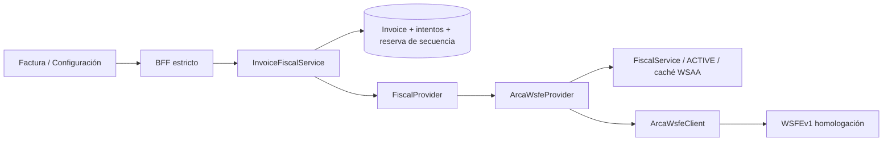

# Facturación V3 — WSFEv1 de homologación

Actualización 29/10/2026: [TA persistente, preflight de numeración y QA V4](arca-v4-persistent-ta.md). El resto de este documento conserva el diseño y la evidencia histórica V3.

Diseño previo a implementación, 28/10/2026, HEAD inicial `8a69aa0`, árbol limpio.
Se preservan la factura comercial V1, sus Remitos/líneas y la credencial ACTIVE existente.
Sin commits, push, PDF, producción, CAEA, notas de crédito/débito, moneda extranjera ni
impuestos adicionales. El certificado y su clave no se regeneran ni se reemplazan.

## Fuentes y contrato

Consulta oficial realizada el 28/10/2026:

- [Índice de homologación](https://www.arca.gob.ar/ws/documentacion/homologacion-externa.asp)
  enlaza [manual FE v4.8](https://www.arca.gob.ar/fe/ayuda/documentos/wsfev1-RG-4291.pdf),
  cuya portada dice revisión **1/12/2026**. Es una publicación anticipada respecto de la
  fecha de consulta. Se informa siempre CondicionIVAReceptorId en V3, sin interpretar
  esa portada como una entrada en vigencia anticipada.
- [Índice general](https://www.arca.gob.ar/ws/documentacion/ws-factura-electronica.asp)
  todavía enlaza v4.7, revisión 1/9/2026. Se contrastaron ambas publicaciones.
- [WSDL actual](https://wswhomo.afip.gov.ar/wsfev1/service.asmx?WSDL), namespace
  `http://ar.gov.afip.dif.FEV1/`, SOAP 1.1 y endpoint exacto de homologación.
  SHA-256 descargado: `16f5b8450c35a2cfc0187f07d6236162bb57b663954a1e1f0267e71afe90af24`.
  Manual 4.8 descargado: `07c1866f67f3e95524464674de6d754fc1e75cfc9f9e915313ba2730f5cd1bf8`.
- Se revisaron las páginas oficiales de operaciones `FECAESolicitar`,
  `FECompUltimoAutorizado`, `FECompConsultar`, `FEParamGetPtosVenta`,
  `FEParamGetCondicionIvaReceptor`, `FEParamGetTiposCbte`, `FEParamGetTiposIva` y
  `FEDummy`, bajo el endpoint anterior (`?op=Nombre`). Sin autoridad de terceros.

El WSDL descargado prevalece sobre errores tipográficos de ejemplos del PDF. Se
registran hashes para hacer reproducible la investigación; no se fija una URL de producción.

## Fronteras y persistencia

InvoicingService continúa siendo comercial y no contiene SOAP. La orquestación fiscal
vive junto al módulo de facturación y depende de un port reemplazable por fake en tests.
No se escriben Inventory, Remitos, allocations ni traces.

Invoice conserva DRAFT/READY y suma fiscalStatus: NOT_SUBMITTED, AUTHORIZING,
AUTHORIZED, REJECTED, UNCERTAIN, CONFLICT. El receptor tiene una condición IVA
estructurada opcional en Customer y en Invoice. Se toma del Customer al marcar READY;
si falta, ADMIN puede completarla explícitamente antes de cualquier envío. No se infiere
del texto libre. El intento congela esa condición, su etiqueta, el emisor y el payload.

InvoiceFiscalAttempt conserva operationId/hash, ordinal, factura/tenant, ambiente,
emisor, POS, tipo, número candidato nullable antes de asignarlo, requestHash/payload
normalizado, estado, dueño/lease, timestamps, resultado, errores/observaciones/eventos,
CAE/vencimiento y resultado de reconciliación. No guarda SOAP, Token, Sign ni claves.
El CAE se guarda solamente en el intento autorizado; la vista de Invoice lo proyecta,
evitando dos fuentes de verdad del resultado. Intentos históricos no se borran.
`authorizedAt` indica cuándo MaxBio registró la autorización (recepción o recuperación
por consulta); no se presenta como la hora de procesamiento interna de ARCA.

FiscalSequence es una reserva durable por organización/ambiente/POS/tipo, nunca un
contador. Apunta al intento que bloquea la secuencia. ArcaIntegrationConfig guarda
el POS elegido y referencias públicas consultadas a ARCA, ligadas a CUIT/credencial.

## Referencias y mapeo

Configuración consulta ARCA explícitamente, muestra únicamente POS de emisión CAE,
no bloqueados ni dados de baja y exige confirmar la selección. Guardar vuelve a
consultar ARCA; no admite un POS inventado. Las referencias tienen vencimiento y
se revalidan al autorizar. ARCA conectado y Listo para emitir son estados distintos.

CondicionIVAReceptorId y compatibilidad A/B/C provienen del método referencial, con
consultas por ClaseCmp. No se decide compatibilidad por el texto del cliente.
Tipos A/B/C se mapean a 1/6/11 y se verifican contra TiposCbte. Emisor Responsable
Inscripto admite A/B; Monotributo o Exento, C; otros casos se bloquean en esta versión.
La autorización definitiva de la combinación sigue perteneciendo a ARCA.

Solo receptores con CUIT canónico válido: DocTipo=80, DocNro=CUIT. V3 bloquea los
casos sin CUIT en lugar de inventar documento o umbrales de consumidor final.
Concepto=1 (bienes), MonId=PES, MonCotiz=1, ImpTrib=0, CantReg=1,
CbteDesde=CbteHasta. Fecha explícita, Buenos Aires: ±5 días y mismo mes para bienes;
se respeta también la fecha del último comprobante de esa secuencia.

IVA 0/10,5/21/27 se mapea a 3/4/5/6, con bases e IVA agrupados. Exento pasa a ImpOpEx;
No gravado a ImpTotConc. ImpNeto contiene solo las bases gravadas. En C el subtotal
completo pasa a ImpNeto y no se informa array IVA ni IVA discriminado. Límite WSFE:
13 enteros + 2 decimales, aunque el dominio comercial permita más.

Se mantienen las sumas comerciales exactas bigint. El manual describe Round Half Even
en WSFE, mientras V1 usa mitad hacia arriba por línea: no se reescriben facturas históricas.
Antes de enviar se comprueba la diferencia racional por alícuota contra la tolerancia
documentada (absoluta ≤ $0,01 o relativa ≤ 0,01%). Si la suma del IVA por líneas excede
esa tolerancia, se bloquea con un mensaje para corregirla. No se cambian totales en silencio.

## Autorización y secuencia

1. Revalidar ADMIN/sesión/tenant, READY, versión y datos. Consultar referencias y obtener
   TA con la ACTIVE mediante la implementación WSAA existente. No se modifica su ciclo.
2. Transacción corta: advisory lock de la secuencia y lock de factura, operationId único
   por tenant, reserva durable, intento PREPARING con lease y factura AUTHORIZING.
   Una reserva abierta bloquea únicamente esa secuencia. No se mantiene una conexión
   DB bloqueada durante llamadas externas.
3. Fuera de transacción: FECompUltimoAutorizado (y comprobante anterior para su fecha).
   El único candidato es ARCA+1. No hay MAX+1 local ni contador fiscal.
4. Transacción corta: verificar dueño/lease/reserva, completar número, payload y hash,
   pasar intento a AUTHORIZING y **hacer commit antes de FECAESolicitar**.
5. Un solo envío. Persistir respuesta y audit en transacción. A libera la secuencia con
   CAE; R definitivo la libera con rechazo. Cualquier entrega/parseo/commit incierto
   mantiene el bloqueo y queda UNCERTAIN. Nunca se reenvía automáticamente.

Mismo operationId y contenido: devuelve el intento existente. Un resultado autorizado
o rechazado se reproduce; uno incierto se consulta. Otra factura no puede adelantar
N+1 mientras N no esté resuelto. Una caída en PREPARING puede abortarse al vencer
el lease porque todavía no se habilitó el envío; un dueño vencido no puede enviarlo.
Una caída después del commit AUTHORIZING siempre requiere consulta, incluso si no
se alcanzó a llamar a ARCA. Un fallo de audit después de CAE no permite duplicar emisión.

## Reconciliación, rechazo e inmutabilidad

FECompConsultar usa el tuple congelado. Se comparan CUIT emisor/identidad de llamada,
POS, tipo/número, fecha, documento, condición IVA, concepto, moneda/cotización,
componentes de importes y grupos IVA. Solo una coincidencia completa recupera CAE.
Datos divergentes producen CONFLICT/FISCAL_SEQUENCE_CONFLICT y mantienen la reserva.
AUTHORIZED puede verificarse otra vez sin mutar sus datos fiscales.

Un 602 controlado es ausencia, no autorización ni rechazo. Solo puede liberar una
operación incierta después de dos consultas separadas y un período de seguridad desde
el envío, si último autorizado sigue siendo exactamente candidato−1. Entonces el intento
queda NOT_FOUND y se habilita una **nueva operación explícita**. Nunca se reutiliza
el operationId anterior para reenviar. Una secuencia que avanzó sin coincidencia queda
bloqueada. Los errores de consulta conservan la incertidumbre.

Tras rechazo definitivo, Corregir factura vuelve explícitamente a DRAFT manteniendo
el intento. AUTHORIZED/UNCERTAIN/AUTHORIZING/CONFLICT no admiten edición, borrado ni
vuelta a borrador. DB refuerza estados, CAE solo autorizado, números positivos, unicidad
del número autorizado por secuencia y congelamiento comercial/fiscal. Auditoría y
transiciones finales son atómicas, con referencias de tenant compuestas.

## Transporte, API y UX

SOAP 1.1 con endpoint HTTPS exacto, sin redirects, timeout 12 s, XML UTF-8 acotado,
sin DTD/entities, profundidad/nodos limitados, campos únicos y namespaces verificados.
Errores tipados y mensajes acotados; sin reflejar secretos o cuerpos XML.

ADMIN configura, autoriza, corrige y reconcilia. OPERATOR solo consulta. Organization
viene del actor. BFF y API validan esquemas strict, Origin y CSRF en mutaciones.
El browser no puede suministrar CAE, número, montos, estado fiscal ni endpoint.

READY muestra requisitos y una confirmación clara de homologación sin efecto fiscal
real. Durante envío, Autorizando con ARCA. Autorizada muestra POS/número/CAE/vencimiento
y Verificar en ARCA; rechazo muestra códigos y Corregir factura; incertidumbre ofrece
Verificar con ARCA sin botón de reenviar. Se muestra historial fiscal de intentos.

Audits: REQUESTED, AUTHORIZED, REJECTED, RESULT_UNCERTAIN, RECONCILED, VERIFIED,
CONFLICT y cambios de configuración/condición IVA. Solo identificadores de recurso,
sin Token/Sign, XML ni datos comerciales en metadata.

## Migraciones y estado conservado

Se aplicaron mediante Prisma Migrate, sin `db push`:

- `20261028200000_invoice_wsfev1`: campos, intentos, reserva de secuencia, índices,
  claves compuestas, constraints y triggers de integridad/inmutabilidad.
- `20261028201000_wsfe_point_of_sale_pair`: refuerza el tuple POS/CUIT/validación
  frente al resultado UNKNOWN de un CHECK con NULL. La primera migración ya aplicada
  permanece intacta.

La instalación inicial tenía una factura comercial y una credencial ACTIVE. Se
compararon todas las columnas comerciales previas y la fila completa de la ACTIVE,
además de los hashes de sus archivos privados, sin imprimir ni copiar sus contenidos.
Todo permanece igual. No se completaron condiciones IVA desde texto libre ni se
configuró un POS ficticio. No se añadieron dependencias.

Los tests históricos de migración ahora seleccionan únicamente las columnas que
existían en sus fixtures previos a V3. Las conexiones de creación/borrado de bases
descartables usan un timeout propio de infraestructura; el límite de consultas del
cliente de aplicación se conserva.

## Verificación

Mapper A/B/C, documento, condición IVA, todas las alícuotas, mezclas, tolerancias y
límites; fixtures SOAP sanitizados y transporte hostil; integración con fake provider
para CAE/rechazo/timeout/reconciliación/replay/concurrencia/tenant/roles/audit/rollback/
inmutabilidad y ausencia de efectos físicos; migración desde datos previos y cero;
tests UI/BFF; lint, formato, typecheck, test, test:database y build.

Pasaron 25 pruebas dirigidas: 7 unitarias WSFE, 13 integraciones fiscales y 5
migraciones históricas. Incluyen 8 solicitudes simultáneas del mismo operationId,
dos facturas de la misma secuencia, lease vencido con el dueño aún en vuelo,
secuencias A/B/C independientes, rollback de audit antes/después de CAE y ausencia
confirmada mediante dos consultas espaciadas, sin segundo envío automático.

Las consultas divergentes reconocen también moneda/documento/concepto diferentes,
la condición IVA histórica ausente y un comprobante registrado mediante CAEA, sin
implementar emisión CAEA ni asociar su autorización al intento local.

La batería final completa se registra en `artifacts/wsfe-final-qa.json`; los logs
locales están en `artifacts/wsfe-final-*.log`. Los resultados finales se agregan abajo.

## Validación real de esta instalación

| Operación                      | Resultado                                              |
| ------------------------------ | ------------------------------------------------------ |
| FEDummy de homologación        | app OK, database OK, authentication OK                 |
| WSAA                           | WAITING; no hay TA operativo en esta ejecución         |
| FEParamGetPtosVenta            | NO EJECUTADO; requiere TA                              |
| FEParamGetCondicionIvaReceptor | NO EJECUTADO; requiere TA                              |
| FECompUltimoAutorizado         | NO EJECUTADO; requiere TA/POS                          |
| FECAESolicitar                 | NO EJECUTADO; no se preparó ni emitió una factura real |
| FECompConsultar real           | NO EJECUTADO; no hay intento emitido                   |

La última comprobación WSAA satisfactoria registrada es del 28/10/2026 15:29:47,
Buenos Aires. El TA anterior no está disponible en memoria de este proceso y la
reserva durable existente impide pedir otro antes del **29/10/2026 03:29:46.875,
Buenos Aires** (`2026-10-29T06:29:46.875Z`). Se preservó esa reserva y la ACTIVE:
no se forzó autenticación, no se regeneraron credenciales ni se cambió su lifecycle.

En la organización real quedan **0 intentos fiscales nuevos, 0 CAE, 0 rechazos y
ningún POS configurado**. La persistencia de CAE/rechazos, numeración y reconciliación
se verificó con proveedor controlado y PostgreSQL descartable. FEDummy confirma la
disponibilidad del servicio, no habilita por sí solo una emisión autenticada.

El smoke FECAESolicitar sigue **NO EJECUTADO**. Cuando exista un TA operativo, primero
deben verificarse las consultas autenticadas, confirmarse el POS y revisarse el tipo,
número candidato, documento/condición IVA del receptor y neto/IVA/total de una única
factura controlada, antes de efectuar su envío de homologación.

## Límites y siguientes versiones

V4: PDF fiscal, QR y representación/impresión del comprobante autorizado, con sus
snapshots y requisitos de presentación validados contra documentación oficial.
V5: habilitación deliberada de producción, certificados y configuración separados,
validación real completa y operación/observabilidad de reconciliación. Una estrategia
segura para mantener TA entre reinicios/procesos pertenece al ciclo WSAA y no fue
rediseñada en V3.

Siguen fuera de alcance CAEA, NC/ND, facturación parcial, moneda extranjera,
servicios/mixto, tributos adicionales y receptores sin CUIT. Un conflicto de secuencia
requiere revisión administrativa; no se ofrece un desbloqueo arbitrario. La UI muestra
los últimos 20 intentos; la base conserva el historial completo.

## Resultado final de QA local

| Comprobación                                     | Resultado                                                   |
| ------------------------------------------------ | ----------------------------------------------------------- |
| `pnpm lint`                                      | OK                                                          |
| `pnpm format:check`                              | OK                                                          |
| `pnpm typecheck`                                 | OK                                                          |
| `pnpm test`                                      | API: 138 aprobadas, 2 opt-in omitidas; web: 72 aprobadas    |
| `pnpm test:database`                             | Database: 1 aprobada; API: 224 aprobadas, 2 opt-in omitidas |
| `pnpm build`                                     | OK: contracts, database, API y Next.js                      |
| Pruebas dirigidas                                | 25 aprobadas                                                |
| API `/api/v1/health`                             | HTTP 200, PostgreSQL OK                                     |
| Frontend `/api/system-status` → API → PostgreSQL | HTTP 200, database OK                                       |
| Frontend `/`                                     | HTTP 200, MaxBio servido                                    |

Los cuatro opt-in preexistentes omitidos son WSAA real y smoke OpenSSL en unitarios,
y Printing BFF real y archivo comercial original opcional en integración. No se
cuentan como aprobados. La validación real fiscal y sus límites están en la sección
anterior; la aprobación de QA local no equivale a una emisión real comprobada.

Se dejó `pnpm dev` ejecutándose: frontend `http://localhost:3000` y API
`http://127.0.0.1:3001`. La comprobación final volvió a confirmar hashes y fila de la
ACTIVE, factura comercial preservada y FEDummy OK. Sin commit ni push;
HEAD conserva `8a69aa0` y los cambios permanecen en el working tree.
